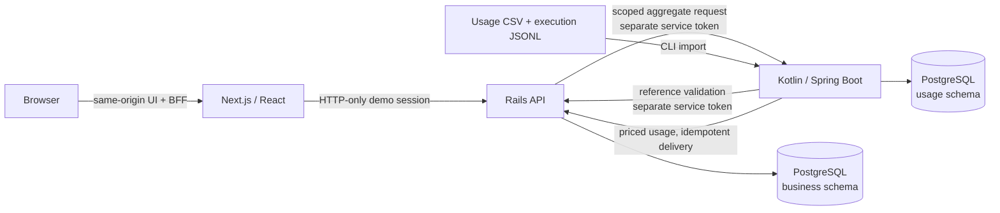

# TokenTrack

> A local-first, full-stack AI spend and execution intelligence platform.

TokenTrack makes AI usage understandable and governable. It ingests metered usage, applies versioned model pricing, attributes spend to people and cross-functional projects, posts authoritative financial records, and presents role-scoped analytics, budgets, funding workflows, and agent execution telemetry in one workspace.

Built as a portfolio-quality systems project, it emphasizes the parts that tend to be difficult in real internal platforms: tenant-aware authorization, immutable financial history, idempotent ingestion and delivery, explicit data ownership, and honest reporting when cost data is incomplete.

## What it demonstrates

- A complete TypeScript, Ruby, Kotlin, and PostgreSQL application—not a static dashboard.
- Role-aware product experiences for leadership, managers, project leads, and employees.
- Canonical usage ingestion with validation, durable diagnostics, deduplication, and deterministic synthetic fixtures.
- Effective-dated AI pricing with precise decimal arithmetic and immutable price provenance.
- An append-only, corrected financial ledger with idempotent delivery and reconciliation.
- Project-first cost attribution that supports cross-functional work without double-counting expenditure.
- Scoped analytics and agent-run efficiency reporting that distinguish observed facts from estimates.
- Budget allocation, personal allowance controls, delegated approval, and auditable funding requests.
- A reproducible local demo using only fictional organizations and synthetic data—no provider credentials or paid AI APIs.

## Product tour

After choosing a fictional demo identity, explore:

| Workspace | What it shows |
| --- | --- |
| Overview, organization, teams, people, and projects | Organizational hierarchy, project collaboration, and backend-enforced visibility boundaries. |
| Analytics | Token use, pricing coverage, corrected ledger expenditure, trends, model/tool breakdowns, project attribution, and ledger audit history. |
| Agents | Explicit run outcomes, attempts, retries, duration, linked usage, and corrected known cost; period comparisons, deterministic anomaly findings with evidence quality, and a cost-driver breakdown. |
| Budgets | Funded accounts, monthly allocations, personal allowances, run-rate controls, and financial history. |
| Requests | Allowance and funding requests routed to the appropriate delegated or financial authority. |

The app intentionally does **not** infer employee productivity from token consumption, estimate missing costs as facts, or predict anything. Agent findings are deterministic comparisons with evidence and suggested investigations, never statements of cause.

## Architecture



| Layer | Stack | Responsibility |
| --- | --- | --- |
| Product UI | Next.js 16, React 19, TypeScript, Tailwind | Responsive workspaces, dark/light themes, route-aware client caching, narrow BFF proxy. |
| Business service | Ruby on Rails 8 API-only | Organizations, sessions, access policy, projects, budgets, approvals, and authoritative finance. |
| Usage service | Kotlin, Spring Boot, JDBC, Flyway | CSV/JSONL contracts, validation, imports, pricing, outbox delivery, agent telemetry, bounded aggregates. |
| Storage | PostgreSQL 17 | Separate `business` and `usage` schemas with separate service write ownership. |
| Local runtime | Docker Compose | Four-service development environment with loopback-only ports. |

### Boundaries that matter

- Browsers never call Kotlin internal analytics endpoints and never receive service credentials.
- Rails authorizes the population before Kotlin aggregates it; directory visibility does not become analytics authority.
- Rails owns financial truth. Kotlin reports operational and token facts; corrected cost is derived from posted ledger entries in Rails.
- Kotlin and Rails share a local PostgreSQL instance for convenience, but write only their own schema.
- Usage, execution, and financial data use stable identities, replay-safe operations, and immutable audit records where history matters.

For more detail, see [architecture](docs/architecture.md), [analytics contract](docs/analytics-contract.md), and the [agent execution contract](contracts/agent-execution-v1.md).

## Quick start

### Prerequisites

- Docker Desktop with Docker Compose
- `openssl` (to generate local service tokens)

```bash
cp .env.example .env
```

Edit `.env` before starting. Replace all three database password placeholders and generate distinct backend-only tokens:

```bash
openssl rand -hex 32
```

Use one generated value each for `USAGE_REFERENCE_TOKEN`, `USAGE_FINANCIAL_TOKEN`, and `USAGE_ANALYTICS_TOKEN`.

Start the stack and load the complete demo:

```bash
docker compose up --build -d
./scripts/setup-demo.sh
```

`setup-demo.sh` applies migrations, seeds the two fictional organizations, creates synthetic funding, imports and prices usage, delivers it to the ledger, imports agent executions, creates budget and request examples, and finishes with a reconciliation summary. It is idempotent: run it again at any time and nothing is duplicated or reset. The individual commands it runs are documented in [development](docs/development.md).

| Service | Address |
| --- | --- |
| App | <http://localhost:3000> |
| Rails health | <http://localhost:3001/api/v1/health> |
| Kotlin health | <http://localhost:8080/actuator/health> |
| PostgreSQL | `localhost:5432` |

Open the app and select a fictional organization and identity. The local demo session is HTTP-only and Rails disables demo authentication in production mode. All demo data is simulated for 2026-11-10 to 2026-12-10, so choose months and date ranges in that window.

Stop the stack with `docker compose down`. The PostgreSQL volume persists unless explicitly removed.

## Demo walkthrough

[docs/demo-walkthrough.md](docs/demo-walkthrough.md) is a six-part tour: leadership analytics, a manager's bounded view, an employee's allowance and request, delegated and financial approval, agent efficiency insights with supporting runs, and ledger reconciliation.

## Demo identities and access model

The demo includes two fictional tenants:

- **Aperture Technologies** — a larger multi-team organization with cross-functional projects.
- **Northstar Labs** — a smaller organization for contrasting scopes and structures.

Try Olivia Chen (organization viewer), Marcus Rivera (team manager), Priya Shah (project lead), and Jordan Lee (employee). Their views differ because every request is evaluated by Rails `AccessPolicy`; navigation and client state are not authorities.

- Organization viewers can inspect their tenant’s organizational reporting data.
- Managers see their managed people and unit scope, not the organization by default.
- Project leads can inspect explicitly led-project activity without receiving unrelated team authority.
- Employees can view their own private usage and allowance information.
- Financial operators are explicit grants; titles, memberships, and read scope never imply financial mutation authority.

## Engineering highlights

### Correctness and auditability

- Usage identity is tenant + source + event ID; execution identity is tenant + source + run ID.
- Import replays are idempotent; conflicting payloads are rejected with durable diagnostics.
- Prices are effective-dated and monetary values use decimal strings/`BigDecimal`, never binary floating point.
- Priced usage flows through a transactional outbox and idempotent Rails financial consumer.
- Financial transactions, ledger entries, corrections, and approval decisions are append-only.
- Corrections reverse/replace expense effects without rewriting the original record.
- Reconciliation makes incomplete pricing/delivery visible instead of silently presenting estimates.

### Privacy and authorization

- Tenant filtering begins every query; out-of-scope resources resolve as not found.
- Internal service calls use independent credentials for references, finance delivery, and analytics.
- The frontend BFF only permits known API paths and forwards the opaque demo session—not service tokens.
- TanStack Query keys include organization, identity, effective access fingerprint, and resource/filter path to prevent cross-identity cache leakage.

### Data contracts

- [Usage event CSV v1](contracts/usage-event-v1.md) documents canonical event ingestion.
- [Priced usage event v1](contracts/priced-usage-event-v1.md) documents Kotlin-to-Rails financial delivery.
- [Agent execution JSONL v1](contracts/agent-execution-v1.md) documents explicit run outcomes, attempts, errors, and read-only usage linkage.

## Verification

```bash
./scripts/verify.sh            # everything below
./scripts/verify.sh frontend   # lint, typecheck, unit tests
./scripts/verify.sh backend    # Rails RSpec, Kotlin unit and PostgreSQL integration tests
./scripts/verify.sh browser    # eight Playwright workflows in the pinned Playwright image
```

Rails specs cover authorization, business constraints, financial integrity, and concurrency. Kotlin integration tests use the isolated test database and the restricted usage role. Browser workflows exercise persona switching, scope boundaries, failures, responsive layouts, and direct-internal-route denial. The projects, budgets and requests workflows write append-only history to the database they run against.

The last recorded run is in [docs/verification/final-results.md](docs/verification/final-results.md).

## Design tradeoffs

- **Two services, one database server.** Kotlin owns usage and pricing, Rails owns people, permissions and money. They share a PostgreSQL instance for local convenience but each writes only its own schema, and they talk over authenticated HTTP rather than reading each other's tables.
- **Authorize first, aggregate second.** Rails resolves who and what the requester may see and passes that population to Kotlin, so analytics cannot be broadened by a filter.
- **At-least-once delivery, exactly-once effect.** Priced events leave Kotlin through a transactional outbox; Rails deduplicates on stable identities, so retries never double-charge.
- **Append-only money.** Corrections are new reversal and adjustment transactions; reconciliation proves the ledger against priced usage instead of trusting it.
- **Limits are not funding.** Personal ceilings and project sublimits are controls that warn; only transfers move funding, and spend is recorded even past a limit.
- **Deterministic insights.** Agent findings are threshold rules with evidence and sample-size states. They report measured change, never a cause or a prediction.
- **Demo over generality.** Identity is a local persona picker, data is synthetic and date-anchored, and aggregates are direct SQL sized for a small dataset.

## Repository guide

```text
scripts/                One-command demo setup and verification
frontend/               Next.js application and browser checks
services/core-api/      Rails API, policies, finance, requests, RSpec
services/usage-engine/  Kotlin ingestion, pricing, analytics, Flyway, JUnit
contracts/              Versioned service and import contracts
demo/                   Fictional organizations, generators, and fixtures
docs/                   Architecture, development, metric definitions, verification
infra/                  PostgreSQL bootstrap and local infrastructure
```

## Project status and limits

TokenTrack is a polished local demonstration environment, not a production deployment. It intentionally excludes real provider integrations, SSO, HRIS/billing connectors, provider-side spend enforcement, multi-region infrastructure, and compliance certification. It does not claim production-scale capacity.

Productionizing it would require a real identity provider, secret management and rotation, HTTPS/hosting, observability, backup and migration operations, provider integration hardening, and an explicit compliance/security program.

## Documentation

- [Local development and troubleshooting](docs/development.md)
- [Architecture](docs/architecture.md)
- [Financial ledger](docs/financial-ledger.md)
- [Model pricing](docs/model-pricing.md)
- [Analytics contract and definitions](docs/analytics-contract.md)
- [Agent efficiency metrics](docs/agent-efficiency-metrics.md)
- [Agent optimization: comparisons, thresholds and insights](docs/agent-optimization.md)
- [Slice 9B report](docs/slice9b.md)
- [Slice 10 report: integration and reliability](docs/slice10.md)
- [Demo walkthrough](docs/demo-walkthrough.md)
- [Final verification results](docs/verification/final-results.md)
- [Demo guide](demo/README.md)
