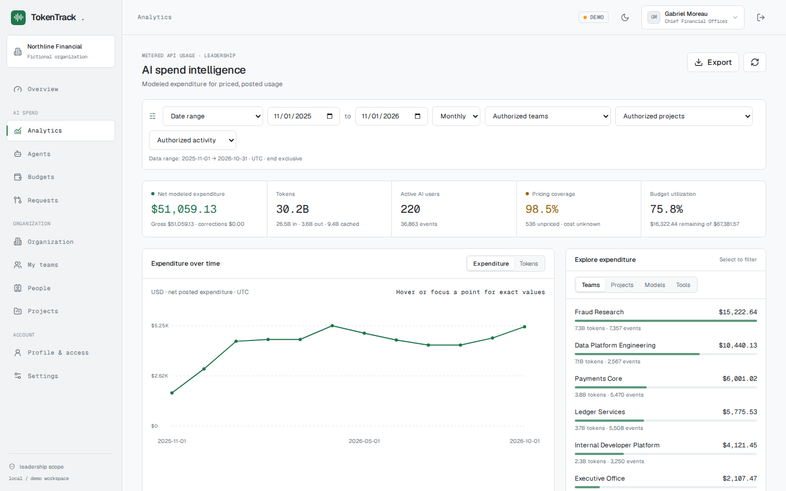
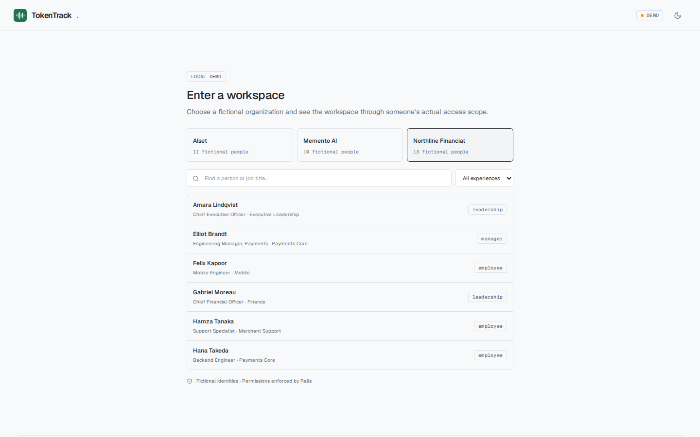
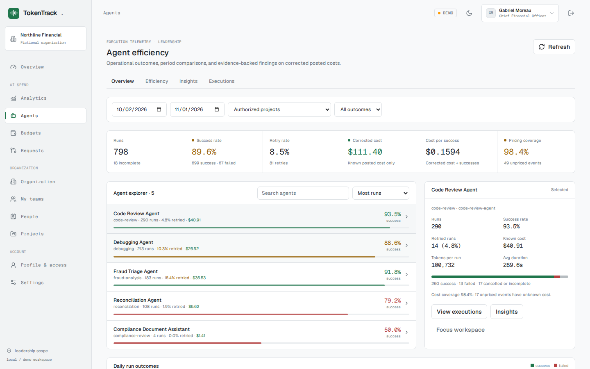
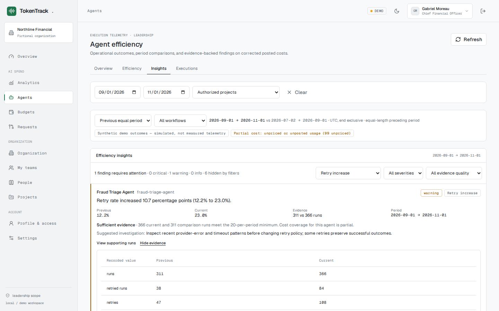
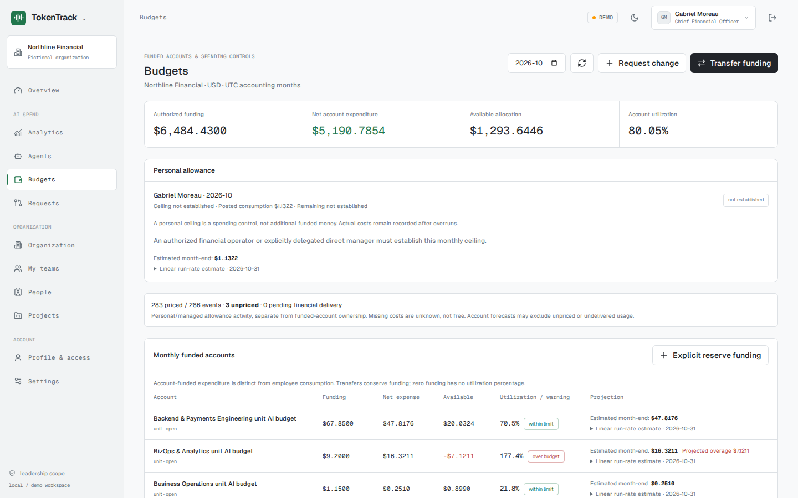
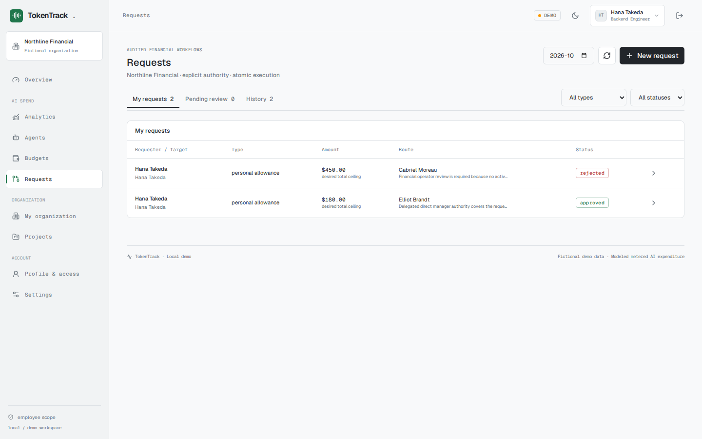
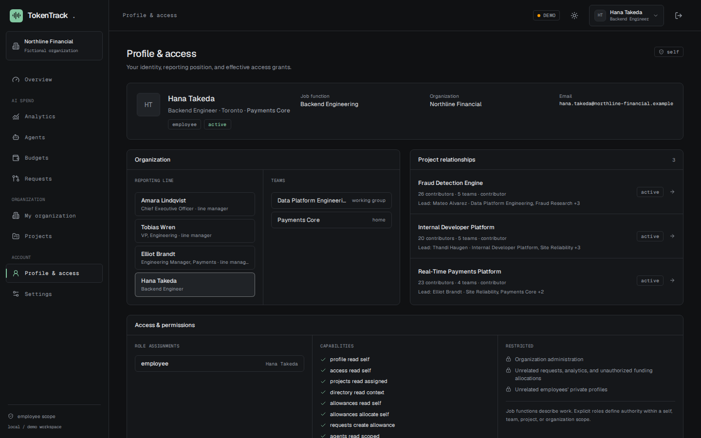
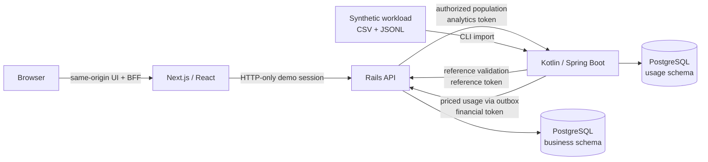
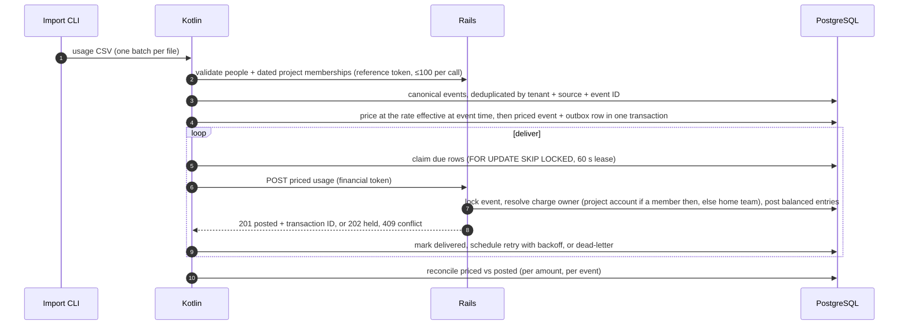
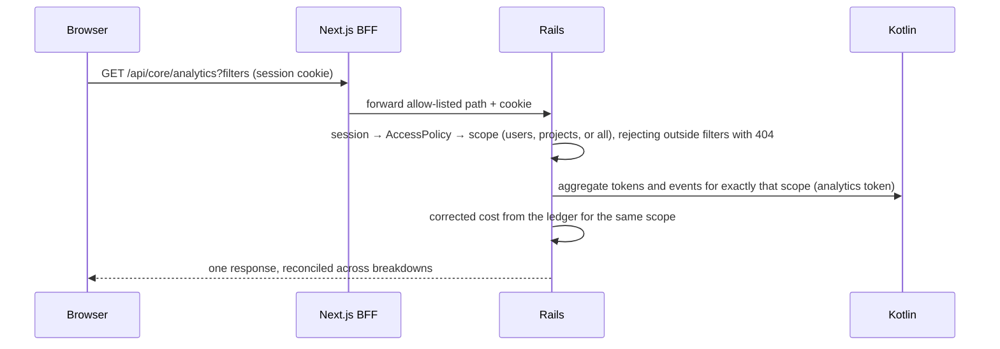

# TokenTrack

**AI spend and agent-efficiency intelligence for organizations.** TokenTrack ingests metered model usage, prices it with effective-dated rates, posts it to an append-only ledger, and gives every person a role-scoped view of where AI money goes, whether budgets hold, and which agents are getting less efficient.

`TypeScript` · `Next.js 16 / React 19` · `Ruby on Rails 8` · `Kotlin / Spring Boot` · `PostgreSQL 17` · `Docker Compose` · `Playwright`



TokenTrack is built around four guarantees: authorization is enforced at the data layer, money is never silently rewritten, every pipeline step can be replayed safely, and reports stay honest when data is incomplete.

## The problem

Companies now spend real money on model APIs and autonomous agents, and the bill usually arrives as one provider invoice with no owner. Finance can't tell which team or project spent it, managers can't see whether their people are within budget, and nobody notices when an agent starts retrying twice as often until the cost has already landed.

TokenTrack answers three questions for each person, scoped to what they're allowed to see:

1. **Where is AI money going?** Spend by team, project, model and tool, reconciled to a ledger, with unpriced usage shown as unknown rather than zero.
2. **Are we within plan?** Monthly funded budgets, personal ceilings and project sublimits, and a request-and-approval flow to move money with an audit trail.
3. **Are our agents getting worse?** Per-agent success, retries, tokens and cost per success over comparable periods, with findings backed by the exact runs behind them.

It deliberately does **not** score employee productivity from token counts, estimate missing costs as facts, or claim causes for agent regressions. Findings say what changed, how confident the evidence is, and where to look.

## One product, five perspectives

Every page is the same for everyone; the data behind it is not. The server decides each person's population before anything is aggregated.

| Persona (demo identity) | Sees | Can do |
| --- | --- | --- |
| **CEO**: Amara Lindqvist | The whole organization: spend, structure, every agent | Start projects |
| **CFO**: Gabriel Moreau | Everything the CEO sees, plus funded accounts and the ledger | Fund, transfer, approve requests, delegate allowance authority |
| **Team manager**: Elliot Brandt | His team and the project he leads | Set his reports' ceilings within a $300 delegated cap, approve their requests |
| **Project lead**: Mateo Alvarez | Activity on the project he leads, not his contributors' other work | Staff the project, request project funding |
| **Engineer**: Hana Takeda | Her own usage, allowance and requests | Rebalance her project sublimits, request a higher allowance |



## Product tour

**Agents: efficiency at a glance.** Runs, success and retry rates, corrected cost and pricing coverage, with each agent coloured by health: green for healthy, amber for attention, red for inefficient.



**Agent insights: evidence, not guesses.** Two equal periods are compared with deterministic rules. Each finding states the change, its evidence quality and sample size, a suggested investigation, and a link to exactly the supporting runs.



**Budgets: plan versus actual.** Funded accounts per team and project, utilization warnings, run-rate projections, and reviewed, idempotent transfers. Spend past a limit is still recorded; limits warn, they don't drop data.



**Requests: routed, audited approvals.** An allowance request goes to the requester's manager when it is within that manager's delegated cap, and to the financial operator otherwise. Approval executes atomically, and every decision is permanent history.



**Profile & access: authority you can inspect.** Reporting line, teams, projects, and the exact grants, capabilities and restrictions behind what each person sees. Light and dark themes throughout.



## At a glance

| | |
| --- | --- |
| **Demo data** | 3 fictional companies (1,100 / 260 / 30 people), 12 months, ~153,000 usage events, ~24,000 agent runs, $356k of posted spend |
| **Services** | Next.js frontend + BFF, Rails business and finance API, Kotlin usage and pricing engine, one PostgreSQL with per-service schemas and roles |
| **Correctness** | Reconciliation: 147,543 priced events = 147,543 ledger postings; zero discrepancies, duplicates or unbalanced transfers |
| **Tests** | 178 RSpec, 68 Kotlin unit + 43 PostgreSQL integration, 17 frontend unit, 8 Playwright end-to-end workflows, all run by one script |

## Architecture



| Service | Owns | Never does |
| --- | --- | --- |
| **Next.js** | Workspaces, theming, identity-scoped TanStack Query cache, a BFF that forwards only allow-listed API paths | Hold service credentials or call Kotlin's internal routes |
| **Rails** | Organizations, people, reporting lines, projects, grants (`AccessPolicy`), budgets, requests, the ledger | Parse usage or compute prices |
| **Kotlin** | Usage and agent-execution contracts, validation, imports, pricing, the outbox, bounded aggregation | Decide who may see what, or write money |
| **PostgreSQL** | `business` schema (Rails role) and `usage` schema (Kotlin role) | Let one service write the other's tables |

Three independent service credentials separate the trust paths: **reference** (Kotlin asks Rails whether a person and project were valid at an event's time), **financial** (Kotlin delivers priced usage to the ledger), and **analytics** (Rails asks Kotlin for aggregates over a population it already authorized). Browsers only ever hold an opaque, HTTP-only session cookie.

### Usage to ledger



Delivery is at-least-once; the effect is exactly-once because Rails deduplicates on stable identities. A crash mid-delivery leaves a lease that expires and is reclaimed, never a double charge.

### Authorized analytics



Authorization happens before aggregation, so no filter or parameter can widen a report. Out-of-scope people, projects and tenants return 404 rather than 403, so their existence isn't confirmed.

## Guarantees

**Money that can't drift**
- Decimal strings and `BigDecimal` end to end; no floating point anywhere money moves.
- Ledger entries, transactions, request events, allowance revisions and delegations are append-only, enforced by PostgreSQL triggers (including `TRUNCATE` guards), not just models. A correction is a reversal plus a replacement.
- Balanced double entry: every transfer has equal and opposite legs, and organization funding is conserved by construction.
- Funding, transfers, controls and approvals all take a client request key, so a retried call returns the original result instead of acting twice.

**Authorization at the data layer**
- Every query starts from the tenant. Grants are explicit and scoped (self, unit subtree, project, organization); job titles grant nothing.
- Approval authority is a capped, dated delegation that is re-checked at decision time, so a revoked delegation or a stale allowance revision can't be approved.
- Client caches are keyed by organization, identity and an access fingerprint, so switching identity can't flash the previous person's data.

**Pipelines that replay safely**
- Imports are idempotent per tenant, source and event ID; a conflicting payload for an existing ID is rejected with stored diagnostics, never overwritten.
- Prices are effective-dated and versioned; repricing never rewrites an existing price snapshot, and unsupported usage stays visibly unpriced.
- Usage is attributed to a project only while a recorded membership covered the event's timestamp; history is never backdated.

**Evidence-based agent findings**
- Equal-length period comparisons; partial weeks and months compare the elapsed portion of both periods.
- Each finding carries a threshold, evidence quality (sufficient, limited sample, incomplete cost data) and supporting-run links; the cost change is split exactly into volume and per-run effects.

## Development

**Contracts.** The usage CSV, priced-usage event and agent-execution JSONL formats are versioned documents in [`contracts/`](contracts/), and both services test against them.

**Demo data.** One spec ([`demo/enterprise/companies-v1.json`](demo/enterprise/companies-v1.json)) drives the Rails seed and the Kotlin generator: departments and offices, AI-intensity tiers by job function, dated project rotations, adoption curves, agents that degrade mid-year, and a funding plan that genuinely over- and under-spends. Same seed and spec give byte-identical files (SHA-256 manifest), and every event goes through the real validation and ledger path; no ledger row is inserted directly.

**Tests.**

| Layer | What it proves |
| --- | --- |
| RSpec (178) | Access policy per persona, tenant isolation, ledger and allowance invariants (including direct-SQL bypass attempts), concurrency of approvals and transfers |
| Kotlin unit (68) | Parsing, validation, pricing arithmetic, insight rules, generator determinism |
| Kotlin + PostgreSQL (43) | Migrations, deduplication under concurrency, partial imports, outbox leases, schema isolation |
| Frontend unit (17) | Money arithmetic and formatting, agent and analytics request building, health aggregation |
| Playwright (8 workflows) | Each persona end to end: scope boundaries, approvals with simulated lost acknowledgements, idempotent transfers, empty, error and loading states, mobile and dark mode |

`./scripts/setup-demo.sh` builds the demo idempotently and fails on any reconciliation discrepancy; `./scripts/verify.sh` runs every suite above.

**Throughput.** Ledger delivery runs at about 90 events/s locally. The outbox claim uses two partial-index queries (expired leases, then due work) because a single `FOR UPDATE SKIP LOCKED` query over the whole queue forced a full scan and sort per batch and capped delivery near 32 events/s. Imports take many files per CLI call, one JVM per company, so a year of usage imports in about 76 seconds.

## Run it

Prerequisites: Docker Desktop and `openssl`.

```bash
cp .env.example .env          # replace the three password placeholders
openssl rand -hex 32          # run three times: USAGE_REFERENCE_TOKEN, USAGE_FINANCIAL_TOKEN, USAGE_ANALYTICS_TOKEN
docker compose up --build -d
./scripts/setup-demo.sh       # ~35 min full load; --profile smoke loads ~10% in a few minutes
./scripts/verify.sh           # lint, typecheck, unit, Rails, Kotlin (unit + PostgreSQL), 8 browser workflows
```

Open <http://localhost:3000> and pick an identity; the [demo walkthrough](docs/demo-walkthrough.md) is a guided tour. Rerunning the setup replays every import as duplicates and moves no totals.

## Repository

```text
frontend/               Next.js app, BFF proxy, Playwright workflows
services/core-api/      Rails API: access policy, projects, budgets, requests, ledger, RSpec
services/usage-engine/  Kotlin: ingestion, pricing, outbox delivery, analytics, Flyway, JUnit
contracts/              Versioned usage, priced-usage and agent-execution contracts
demo/                   Company spec, spec builder, synthetic historical pricing
scripts/                One-command demo setup and verification
docs/                   Architecture, ledger, pricing, analytics, agent metrics, screenshots
```

## Scope and trade-offs

- **Local-first by design.** Identity is a persona picker backed by real server sessions, and Rails refuses demo sign-in in production. Production would need SSO, secret management, hosting, observability and backups.
- **Two services, one database server.** Clear ownership without running two databases; services talk over authenticated HTTP, never shared tables.
- **Direct SQL aggregation.** Fine for the demo, but a year of the 1,100-person company takes a few seconds; production would pre-aggregate.
- **Synthetic data only.** No provider credentials, paid APIs or real organizations; historical rates are labelled synthetic and agent outcomes simulated.

## Documentation

[Architecture](docs/architecture.md) · [Financial ledger](docs/financial-ledger.md) · [Model pricing](docs/model-pricing.md) · [Analytics contract](docs/analytics-contract.md) · [Agent efficiency metrics](docs/agent-efficiency-metrics.md) · [Agent optimization](docs/agent-optimization.md) · [Budgets and allowances](docs/budget-allowances.md) · [Demo data](docs/enterprise-demo-data.md) · [Demo walkthrough](docs/demo-walkthrough.md) · [UI conventions](docs/ui-conventions.md) · [Development](docs/development.md)
