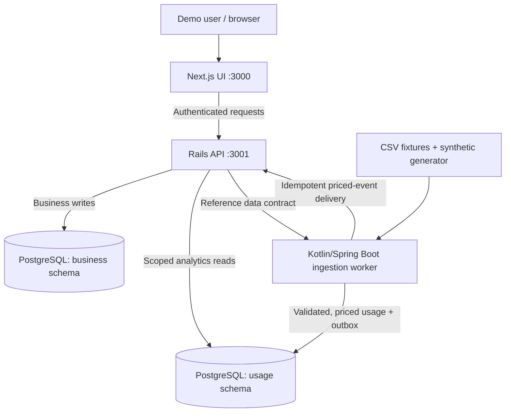
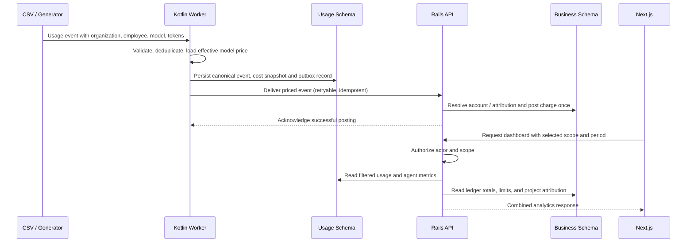

# AI Spend Intelligence

> **Status:** Architecture and planning stage — implementation has not started.
>
> A local-first, simulated B2B SaaS platform for understanding AI usage, attributing costs to projects, measuring workflow efficiency, and managing budgets through delegated approvals.

## 1. Problem and product vision

Organizations use LLM APIs, coding assistants, AI subscriptions, and autonomous agents across engineering, product, design, sales, HR, and other functions. Financial leaders need to understand company-wide spending, managers need team and project visibility, and individual contributors need to understand their usage and available allowances.

**AI Spend Intelligence** connects usage observability to financial decisions:

- Analyze token and subscription spending by organization, team, employee, project, tool, model, and time period.
- Investigate daily, weekly, and monthly spending changes and anomalous agent behavior.
- Compare similar workflows using cost-per-success, retry rates, and other explicitly defined outcomes—not arbitrary employee productivity rankings.
- Attribute AI spending to cross-functional projects without double-counting company expenditure.
- Allocate funded budgets, define employee spending ceilings, and route funding requests to authorized approvers.
- Run a reproducible demo using **fictional organizations and synthetic data**, without accessing actual company data or paid AI APIs.

The project is also intended to demonstrate **Kotlin, Ruby on Rails, relational data design, financial correctness, API design, authorization, testing, and full-stack development**.

## 2. Scope and deliberate non-goals

### Initial scope

- Two example organization structures: a small startup and a larger, multi-team company.
- Selectable demo identities with real, backend-enforced role and resource scopes.
- Local CSV/synthetic usage ingestion and effective-dated LLM pricing.
- Metered AI usage and fixed monthly AI subscription costs, accounted for separately.
- Team, project, employee, tool/model, and agent analytics.
- Monthly funded pools, spending limits, transfers, requests, delegated approvals, and audit history.
- Light/dark mode with a minimal, terminal-inspired UI.

### Not in the first version

- Real integrations with LLM providers, SSO, HRIS, or billing vendors.
- Provider-side spending enforcement or blocking API access.
- Kafka, Kubernetes, a separate data warehouse, and distributed microservice infrastructure.
- Automated claims about individual productivity based solely on token consumption.
- Production-ready 10,000-user scalability or compliance certification.

## 3. Technology and ownership

| Component | Technology | Owns |
|---|---|---|
| Web application | Next.js, React, TypeScript | UI, charts, theme, role-aware navigation |
| Business API | Ruby on Rails (API-only) | Organizations, users, projects, scopes, budgets, approvals, cost attribution, financial ledger |
| Usage engine | Kotlin + Spring Boot | CSV ingestion, validation, deduplication, effective-dated pricing, canonical usage events, agent run statistics, usage aggregates |
| Database | Local PostgreSQL in Docker | Separate logical `business` and `usage` schemas |
| Local orchestration | Docker Compose | Database, Rails API, Kotlin worker, frontend (optionally) |
| Tests | RSpec and JUnit 5, plus frontend tests | Business and financial invariants, pricing and ingestion correctness, role access |

**Boundary:** Browsers only call Rails. Kotlin processes usage asynchronously and supplies priced events to Rails for authoritative financial posting. The services may share a PostgreSQL instance for the demo, but **each service exclusively writes its own schema**. Rails may read documented usage views for scoped analytics. Kotlin obtains valid identifiers/reference data through a defined contract rather than modifying business records.

## 4. Local system diagram



The Kotlin worker does **not** need a publicly exposed HTTP port initially. Its delivery to Rails can use an internal HTTP endpoint on the Compose network. The frontend will use port 3000; Rails will use port 3001. PostgreSQL can be mapped to port 5432 for development tools or kept internal to Docker.

## 5. Conceptual entity-relationship diagram

This diagram shows major entities, not every column or constraint. `organization_id` scoping and audit fields will be included throughout the physical schema.


**Physical-model refinements planned:**

- `approval_policies`, `reporting_relationships`, `subscription_assignments`, `subscription_charges`, `usage_outbox`, delivery attempts, and `ledger_transaction_groups` will be defined when implementing those slices.
- Funding movements require paired debit/credit postings or a transaction group with balanced legs; the diagram abbreviates these as `BUDGET_TRANSACTIONS`.
- Budget ownership is scoped to organization, organizational unit, or project. Prefer validated owner references/constraints over unchecked polymorphic references where practicable.
- `SPENDING_LIMITS` can include a nullable project ID for employee project sublimits; it is **not** a funded pool.
- At most one **active** 100% project attribution per event initially, otherwise unassigned. Historical changes are audited. Optional percentage splitting is deferred.
- The source usage ID uniquely identifies an expense posting for idempotency. Corrections use reversal/adjustment entries.
- Cross-schema IDs are checked through documented contracts and tenant-aware validation; each backend owns its schema's writes.

## 6. Financial domain rules

1. **Funding pools** belong to the organization, team, or project. Internal transfers move funding between pools but never create new organization-level funding.
2. **Employee allowances** and per-project personal sublimits cap permitted consumption but do not increase funded balances.
3. **Project attribution** identifies the project responsible for an expense. A single charge is reportable under several analytical dimensions, but is recognized only once.
4. **One funded charge owner per expense** in version one. Multi-party project funding occurs via transfers into the project pool, not by charging the same expense to several pools.
5. **Actual expense != authorization:** already-incurred usage is still posted even if a budget/limit was breached. The system displays an overage; it does not claim to shut off external AI providers.
6. **Fixed subscription spend** is distinct from metered token spend. Included token activity must not be double-billed.
7. **Effective-dated pricing** preserves the actual rate snapshot used when pricing each usage event; historical costs don't change with today's price catalog.
8. **Ledger records are append-only**; corrections are reversals/adjustments. Monetary precision/rounding must be explicit and tested.
9. **Approval is transactional:** valid authority, available funding, state transition, balance update, and audit record are committed atomically.
10. **Tenant and scope authorization** is checked by Rails on every relevant read and write, including drill-downs and approval actions.

## 7. Ingestion-to-dashboard flow



A delivered event may remain temporarily **unassigned** if a valid charge owner cannot be resolved. That must be visible in reconciliation; the underlying usage event is not discarded. The design is eventually consistent across the two services rather than pretending both databases commit as one transaction.

## 8. Main product workflows

1. **Organization investigation:** leadership compares monthly or weekly spending, drills down from organization → teams/projects → employee, model, and agent.
2. **Manager review:** managers inspect direct reports and team usage, view exceptions, and authorize individual requests within delegated limits.
3. **Employee usage:** contributors inspect model consumption, agent success, personal limits, and project-level attribution.
4. **Agent optimization:** compare agent run costs, failures/retries, and outcomes across models or equivalent workflows.
5. **Usage jumps:** inspect sudden week-over-week or month-over-month increases and identify the driving tools, projects, and people.
6. **Tool/model optimization:** identify disproportionately expensive models and underused paid subscriptions, with defensible context.
7. **Project funding:** monitor cross-functional project spend versus its funded monthly budget.
8. **Personal project sublimits:** employees distribute their allowed usage across projects without transferring company funding.
9. **Delegated funding request:** employee or project owner requests more funding; Rails routes to a scoped approver and commits authorized changes with a ledger/audit trail.

### Efficiency interpretation

Token usage is **consumption**, not productivity. Compare cost per successful agent run, failure/retry rates, and comparable workflows. Time-saved or business-impact estimates in synthetic data must be labeled as simulated and should not be used to rank unrelated job functions.

## 9. Demo data and identities

Use a deterministic generator with a fixed seed and checked-in CSV fixture examples. Suggested scenarios:

- Small startup: flat organization, founder manages funding, staff works across several projects.
- Larger company: engineering/product/design/operations teams, hierarchical budgets and delegated approvals.
- Engineering agent with a sudden retry/cost spike.
- Cross-functional project with competing budget requests.
- Underused fixed-price AI seats.
- Agent model switch improving cost per successful run.

The demo persona switcher must select **actual seeded identities and authorization scopes**. It must not merely change labels or hide frontend navigation while exposing unrestricted API endpoints.

## 10. Proposed monorepo layout

```text
ai-spend-intelligence/
├── frontend/                     # Next.js, React, TypeScript
│   ├── app/
│   ├── components/
│   └── lib/
├── services/
│   ├── core-api/                 # Rails API, business schema, ledger, approvals
│   │   ├── app/models/
│   │   ├── app/controllers/
│   │   ├── app/services/
│   │   ├── app/policies/
│   │   └── spec/
│   └── usage-engine/             # Kotlin/Spring Boot ingestion and costing
│       └── src/
│           ├── main/kotlin/
│           └── test/kotlin/
├── contracts/                    # Versioned usage and priced-event schemas
├── demo/
│   ├── fixtures/                 # Synthetic CSV records
│   └── scenarios/                # Reproducible demo narratives
├── docs/
│   ├── architecture.md
│   ├── domain-model.md
│   └── financial-rules.md
├── docker-compose.yml
├── .env.example
└── README.md
```

## 11. Local development plan

> The following is a **target workflow**, not a claim that runnable code already exists. Docker Compose files, application scaffolds, migrations, seeds, and scripts must be implemented first.

### Prerequisites

- Docker Desktop with Docker Compose.
- Git.
- Optionally Node.js, Ruby, JDK, and Gradle for running services outside containers.

### Planned setup

```bash
# Once docker-compose.yml and Dockerfiles are implemented:
cp .env.example .env

docker compose up --build
```

Planned local ports:

| Service | URL / Port |
|---|---|
| Next.js UI | `http://localhost:3000` |
| Rails API | `http://localhost:3001` |
| PostgreSQL | `localhost:5432` when exposed for development |
| Kotlin worker | No public port required |

Later, we will define explicit migration and seed commands and make `docker compose up` straightforward to use. Keep credentials in `.env` and never commit actual secrets. All seeded identities and company records should be fictional.

## 12. Implementation slices

### Slice 1 — Local foundation

- Scaffold Next.js, Rails API-only app, Kotlin Spring Boot project, and Docker Compose.
- Start local PostgreSQL and establish two database schemas.
- Create fictional organization, units, users, project membership, and scoped demo authentication.
- Render a role-aware light/dark dashboard shell.

### Slice 2 — Usage and pricing

- Define versioned input-event and priced-event JSON schemas.
- Build CSV ingestion, validation, deduplication, price snapshots, and Kotlin tests.
- Persist events and reliable delivery records in the usage schema.

### Slice 3 — Ledger and analytics

- Create project/team funding accounts, monthly budget periods, and append-only charge postings.
- Add idempotent Rails ingestion of Kotlin-priced events.
- Expose scoped spend endpoints for organization, team, project, and employee views.
- Ensure total spend reconciles across dimensions.

### Slice 4 — Limits and approvals

- Implement employee and project sublimits.
- Implement funding requests, delegated policy routing, approval state machine, audit history, and atomic funding transfers.

### Slice 5 — Agents and intelligence

- Add agent runs and workflow outcomes.
- Implement weekly/monthly trend comparisons, cost anomaly rules, tool/model breakdowns, and efficiency metrics.

### Slice 6 — Demo polish

- Seed multiple organization structures and realistic anomalies.
- Add resettable demo scenarios, tests, documentation, and a repeatable local walkthrough.

## 13. Acceptance criteria for the first complete vertical slice

- `docker compose up --build` starts the local application after initial setup/migrations.
- A seeded employee belongs to a home team and a cross-functional project.
- Kotlin ingests a CSV event, prices it deterministically, and stores one canonical event.
- Rails posts exactly one financial charge for the event, including on repeated delivery.
- The charge is attributed to the appropriate project and charge owner.
- Authorized employee, manager, and leadership dashboards show correctly scoped data.
- Organization spend includes the event exactly once, even if the event is displayed under employee, team, and project reports.
- Unauthorized cross-team and cross-organization queries are denied by the API.

## 14. Open decisions for the implementation stage

These are intentionally left explicit rather than silently assumed:

- How to implement seeded demo authentication locally (session-based Rails auth versus a development-only identity switch mechanism).
- Exact event identifiers, pricing rate units and rounding precision.
- Detailed budget ledger posting schema and handling of late or reclassified charges.
- Whether pre-aggregated statistics are required initially or SQL queries are sufficient for the seeded dataset.
- Service-to-service authentication for priced-event delivery.
- API contracts, pagination, and monthly reporting timezone conventions.

---

**Architecture principle:** Organizations define their reporting structures and approval authority; the system consistently measures usage, attributes one authoritative cost, enforces permissions, and connects financial insight to decisions.
