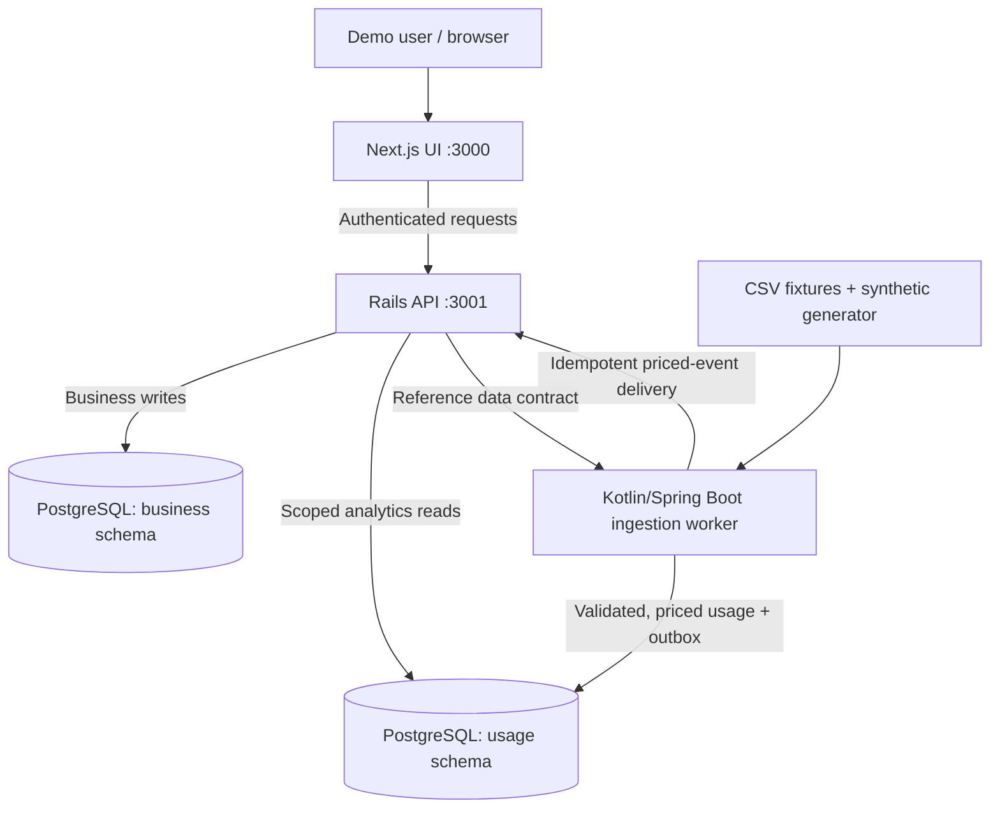
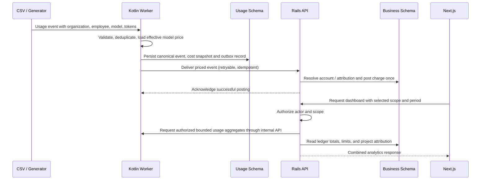

# TokenTrack — AI Spend Intelligence

> **Status:** Slices 1–8 implemented: local infrastructure, organizational modeling, scoped access control, authenticated demo experiences, cross-functional project management, Kotlin usage ingestion, effective-dated pricing, durable delivery, an append-only financial ledger, scoped analytics dashboards, operational budget/allowance controls, and auditable funding requests with delegated approvals. Product workflows below are planned unless explicitly marked implemented.
>
> A local-first B2B SaaS-style platform for understanding AI usage, attributing costs to projects, measuring workflow efficiency, and managing budgets through delegated approvals.

## Start here — implemented workspace

TokenTrack runs Next.js, Rails API-only, Kotlin/Spring Boot, and PostgreSQL. Enter Northstar Labs (10 fictional people) or Aperture Technologies (64), then switch authenticated demo identities to explore leadership, manager, project lead, and employee workspaces. Profiles, projects, usage ingestion/pricing, ledger-backed analytics, funded budgets, personal controls, and request workflows are operational. Employees can request allowance increases, project leads and managers can request scoped funding, delegated managers can decide within capped authority, and financial operators can execute balanced transfers. Approved effects appear in Budgets and Analytics without counting requests as expenditure. Demo sign-in is local-only and always disabled in Rails production.

```bash
cp .env.example .env
# Replace the three example passwords, USAGE_REFERENCE_TOKEN and USAGE_FINANCIAL_TOKEN in .env.
# Generate each separate service token with: openssl rand -hex 32
docker compose up --build -d
# First setup, or after adding migrations:
docker compose exec core-api bin/rails db:migrate db:seed
docker compose exec -e RAILS_ENV=test core-api bin/rails db:migrate
```

| Service | Local address |
| --- | --- |
| Frontend | <http://localhost:3000> |
| Rails health | <http://localhost:3001/api/v1/health> |
| Kotlin health | <http://localhost:8080/actuator/health> |
| PostgreSQL | `localhost:5432` |

Open the frontend and choose an organization and identity. Stop with `docker compose down`; the database volume persists. Ports and `DEMO_AUTH_ENABLED` are configurable in `.env`. The migration/seed command above is required on a fresh database; seeds are repeatable.

```bash
docker compose exec frontend npm run lint
docker compose exec frontend npm run typecheck
docker compose exec frontend npm test
docker compose exec core-api bundle exec rspec
docker compose exec usage-engine gradle test
```

See [development and reset instructions](docs/development.md), [current architecture](docs/architecture.md), and [current Slice 6 implementation and verification](docs/slice6.md). Olivia and Maya have explicit organization-scoped project creation grants; Priya has delegated creation authority. An explicit project lead grant permits project administration. A collaboration label, team-manager role, or leadership read grant alone does not.

Generate and import usage after startup (choose an explicit date window overlapping the exported project membership periods):

```bash
demo/generators/generate-usage.sh 2026-11-10 2026-12-10 42
docker compose exec usage-engine bin/usage import /app/demo/fixtures/usage-events-v1.csv --source demo-synthetic-v1
# Repeating that import inserts zero new events; inspect batch IDs from its JSON report:
docker compose exec usage-engine bin/usage list
docker compose exec usage-engine gradle integrationTest
```

The original product vision and conceptual domain design are preserved below; they describe future functionality, not implemented tables or endpoints.


## 1. Problem and product vision

Organizations use LLM APIs, coding assistants, AI subscriptions, and autonomous agents across engineering, product, design, sales, HR, and other functions. Financial leaders need to understand company-wide spending, managers need team and project visibility, and individual contributors need to understand their usage and available allowances.

**TokenTrack** will connect usage observability to financial decisions:

- Analyze token and subscription spending by organization, team, employee, project, tool, model, and time period.
- Investigate daily, weekly, and monthly spending changes and anomalous agent behavior.
- Compare similar workflows using cost-per-success, retry rates, and other explicitly defined outcomes—not arbitrary employee productivity rankings.
- Attribute AI spending to cross-functional projects without double-counting company expenditure.
- Allocate funded budgets, define employee spending ceilings, and route funding requests to authorized approvers.
- Run a reproducible demo using **fictional organizations and synthetic data**, without accessing actual company data or paid AI APIs.

The project is also intended to demonstrate **Kotlin, Ruby on Rails, relational data design, financial correctness, API design, authorization, testing, and full-stack development**.

## 2. Scope and deliberate non-goals

### Product scope (organizational and backend financial features implemented)

- Two example organization structures: a small startup and a larger, multi-team company.
- Selectable demo identities with real, backend-enforced role and resource scopes.
- Local CSV/synthetic usage ingestion (implemented); effective-dated LLM pricing (implemented).
- Metered AI usage and fixed monthly AI subscription costs, accounted for separately.
- Team, project, employee, tool/model, and agent analytics.
- Monthly funded pools, spending limits, transfers, requests, delegated approvals, and audit history.
- Light/dark mode with a minimal, terminal-inspired UI.

### Not in the first version

- Real integrations with LLM providers, SSO, HRIS, or billing vendors.
- Provider-side spending enforcement or blocking API access.
- Kafka, Kubernetes, a separate data warehouse, and distributed microservice infrastructure.
- Automated claims about individual productivity based solely on token consumption.
- Production-ready 10,000-user scalability or compliance certification.

## 3. Technology and ownership

| Component | Technology | Owns |
|---|---|---|
| Web application | Next.js, React, TypeScript | UI, charts, theme, role-aware navigation |
| Business API | Ruby on Rails (API-only) | Organizations, users, projects, scopes, budgets, approvals, cost attribution, financial ledger |
| Usage engine | Kotlin + Spring Boot | CSV ingestion, validation, deduplication, effective-dated pricing, canonical usage events, agent run statistics, usage aggregates |
| Database | Local PostgreSQL in Docker | Separate logical `business` and `usage` schemas |
| Local orchestration | Docker Compose | Database, Rails API, Kotlin service, frontend |
| Tests | RSpec and JUnit 5, plus frontend tests | Business and financial invariants, pricing and ingestion correctness, role access |

**Service boundary:** Browsers call Next.js. Its `/api/core/*` proxy forwards an HTTP-only demo session to Rails for organizational APIs, while `/api/health` checks both backends server-side. Kotlin prices canonical usage and delivers durable outbox events to Rails for authoritative financial posting. The services may share a PostgreSQL instance for the demo, but **each service exclusively writes its own schema**. Rails requests bounded usage aggregates through the separately authenticated internal Kotlin API. Kotlin obtains valid identifiers/reference data through a defined contract rather than modifying business records.

## 4. Conceptual future system diagram



Slice 1 exposes Kotlin Actuator health on port **8080**, Rails on **3001**, Next.js on **3000**, and PostgreSQL on **5432**. All host ports bind to loopback. Future priced-event delivery can use internal HTTP on the Compose network. The current system and identity diagrams is in [docs/architecture.md](docs/architecture.md).

## 5. Conceptual entity-relationship diagram

This diagram shows major entities, not every column or constraint. `organization_id` scoping and audit fields will be included throughout the physical schema.

```mermaid
erDiagram
    ORGANIZATIONS ||--o{ USERS : contains
    ORGANIZATIONS ||--o{ ORG_UNITS : contains
    ORG_UNITS ||--o{ ORG_UNITS : parent_of
    USERS ||--o{ ORG_MEMBERSHIPS : has
    ORG_UNITS ||--o{ ORG_MEMBERSHIPS : includes
    ORGANIZATIONS ||--o{ PROJECTS : owns
    PROJECTS ||--o{ PROJECT_MEMBERSHIPS : includes
    USERS ||--o{ PROJECT_MEMBERSHIPS : joins
    USERS ||--o{ ROLE_ASSIGNMENTS : holds

    ORGANIZATIONS ||--o{ BUDGET_ACCOUNTS : owns
    BUDGET_ACCOUNTS ||--o{ BUDGET_PERIODS : has
    BUDGET_PERIODS ||--o{ BUDGET_TRANSACTIONS : records
    USERS ||--o{ SPENDING_LIMITS : constrained_by
    USERS ||--o{ FUNDING_REQUESTS : submits
    FUNDING_REQUESTS ||--o{ APPROVAL_EVENTS : audited_by

    ORGANIZATIONS ||--o{ USAGE_EVENTS : incurs
    USERS ||--o{ USAGE_EVENTS : generates
    AI_MODELS ||--o{ MODEL_PRICES : has
    AI_MODELS ||--o{ USAGE_EVENTS : used_by
    AI_TOOLS ||--o{ USAGE_EVENTS : used_by
    AGENT_RUNS o|--o{ USAGE_EVENTS : groups
    USAGE_EVENTS ||--o| USAGE_ATTRIBUTIONS : classified_by
    PROJECTS ||--o{ USAGE_ATTRIBUTIONS : receives
    USAGE_EVENTS ||--o| BUDGET_TRANSACTIONS : charged_once

    ORGANIZATIONS {
        uuid id PK
        string name
        string currency
    }
    ORG_UNITS {
        uuid id PK
        uuid organization_id FK
        uuid parent_id FK
        string name
        string unit_type
    }
    USERS {
        uuid id PK
        uuid organization_id FK
        string job_function
    }
    ORG_MEMBERSHIPS {
        uuid id PK
        uuid user_id FK
        uuid org_unit_id FK
        boolean primary_membership
    }
    ROLE_ASSIGNMENTS {
        uuid id PK
        uuid user_id FK
        string role
        string scope_type
        uuid scope_id
    }
    PROJECTS {
        uuid id PK
        uuid organization_id FK
        string name
        string status
    }
    PROJECT_MEMBERSHIPS {
        uuid id PK
        uuid project_id FK
        uuid user_id FK
    }
    BUDGET_ACCOUNTS {
        uuid id PK
        uuid organization_id FK
        string owner_type
        uuid owner_id
    }
    BUDGET_PERIODS {
        uuid id PK
        uuid account_id FK
        date month_start
    }
    BUDGET_TRANSACTIONS {
        uuid id PK
        uuid period_id FK
        uuid source_usage_event_id
        decimal amount
        string type
    }
    SPENDING_LIMITS {
        uuid id PK
        uuid user_id FK
        uuid project_id
        date month_start
        decimal amount
    }
    FUNDING_REQUESTS {
        uuid id PK
        uuid requester_id FK
        decimal amount
        string status
    }
    APPROVAL_EVENTS {
        uuid id PK
        uuid request_id FK
        uuid actor_id FK
        string action
    }
    USAGE_EVENTS {
        uuid id PK
        uuid organization_id FK
        uuid user_id FK
        uuid model_id FK
        uuid tool_id FK
        int input_tokens
        int output_tokens
        decimal priced_cost
    }
    USAGE_ATTRIBUTIONS {
        uuid id PK
        uuid usage_event_id FK
        uuid project_id FK
        string method
    }
    AI_MODELS {
        uuid id PK
        string provider
        string name
    }
    MODEL_PRICES {
        uuid id PK
        uuid model_id FK
        decimal input_rate
        decimal output_rate
        datetime effective_from
    }
    AI_TOOLS {
        uuid id PK
        string billing_type
        string name
    }
    AGENT_RUNS {
        uuid id PK
        uuid user_id FK
        string status
    }
```



**Physical-model refinements planned:**

- `reporting_relationships` is implemented in Slice 2. `approval_policies`, `subscription_assignments`, `subscription_charges`, `usage_outbox`, delivery attempts, and `ledger_transaction_groups` will be defined when implementing those slices.
- Funding movements require paired debit/credit postings or a transaction group with balanced legs; the diagram abbreviates these as `BUDGET_TRANSACTIONS`.
- Budget ownership is scoped to organization, organizational unit, or project. Prefer validated owner references/constraints over unchecked polymorphic references where practicable.
- `SPENDING_LIMITS` can include a nullable project ID for employee project sublimits; it is **not** a funded pool.
- At most one **active** 100% project attribution per event initially, otherwise unassigned. Historical changes are audited. Optional percentage splitting is deferred.
- The source usage ID uniquely identifies an expense posting for idempotency. Corrections use reversal/adjustment entries.
- Cross-schema IDs are checked through documented contracts and tenant-aware validation; each backend owns its schema's writes.

## 6. Financial domain rules

1. **Funding pools** belong to the organization, team, or project. Internal transfers move funding between pools but never create new organization-level funding.
2. **Employee allowances** and per-project personal sublimits cap permitted consumption but do not increase funded balances.
3. **Project attribution** identifies the project responsible for an expense. A single charge is reportable under several analytical dimensions, but is recognized only once.
4. **One funded charge owner per expense** in version one. Multi-party project funding occurs via transfers into the project pool, not by charging the same expense to several pools.
5. **Actual expense != authorization:** already-incurred usage is still posted even if a budget/limit was breached. The system displays an overage; it does not claim to shut off external AI providers.
6. **Fixed subscription spend** is distinct from metered token spend. Included token activity must not be double-billed.
7. **Effective-dated pricing** preserves the actual rate snapshot used when pricing each usage event; historical costs don't change with today's price catalog.
8. **Ledger records are append-only**; corrections are reversals/adjustments. Monetary precision/rounding must be explicit and tested.
9. **Approval is transactional:** valid authority, available funding, state transition, balance update, and audit record are committed atomically.
10. **Tenant and scope authorization** is checked by Rails on every relevant read and write, including drill-downs and approval actions.

## 7. Ingestion-to-dashboard flow



A delivered event may remain temporarily **unassigned** if a valid charge owner cannot be resolved. That must be visible in reconciliation; the underlying usage event is not discarded. The design is eventually consistent across the two services rather than pretending both databases commit as one transaction.

## 8. Main product workflows

1. **Organization investigation:** leadership compares monthly or weekly spending, drills down from organization → teams/projects → employee, model, and agent.
2. **Manager review:** managers inspect direct reports and team usage, view exceptions, and authorize individual requests within delegated limits.
3. **Employee usage:** contributors inspect model consumption, agent success, personal limits, and project-level attribution.
4. **Agent optimization:** compare agent run costs, failures/retries, and outcomes across models or equivalent workflows.
5. **Usage jumps:** inspect sudden week-over-week or month-over-month increases and identify the driving tools, projects, and people.
6. **Tool/model optimization:** identify disproportionately expensive models and underused paid subscriptions, with defensible context.
7. **Project funding:** monitor cross-functional project spend versus its funded monthly budget.
8. **Personal project sublimits:** employees distribute their allowed usage across projects without transferring company funding.
9. **Delegated funding request:** employee or project owner requests more funding; Rails routes to a scoped approver and commits authorized changes with a ledger/audit trail.

### Efficiency interpretation

Token usage is **consumption**, not productivity. Compare cost per successful agent run, failure/retry rates, and comparable workflows. Time-saved or business-impact estimates in synthetic data must be labeled as simulated and should not be used to rank unrelated job functions.

## 9. Demo data and identities

Current deterministic organizational seeds are described in [demo/README.md](demo/README.md). Future usage scenarios will use a deterministic generator and CSV fixtures; these are not implemented yet:

- Small startup: flat organization, founder manages funding, staff works across several projects.
- Larger company: engineering/product/design/operations teams, hierarchical budgets and delegated approvals.
- Engineering agent with a sudden retry/cost spike.
- Cross-functional project with competing budget requests.
- Underused fixed-price AI seats.
- Agent model switch improving cost per successful run.

The demo persona switcher must select **actual seeded identities and authorization scopes**. It must not merely change labels or hide frontend navigation while exposing unrestricted API endpoints.

## 10. Proposed monorepo layout

```text
tokentrack/
├── frontend/                     # Next.js, React, TypeScript
│   ├── app/
│   ├── components/
│   └── lib/
├── services/
│   ├── core-api/                 # Rails API, business schema, ledger, approvals
│   │   ├── app/models/
│   │   ├── app/controllers/
│   │   ├── app/services/
│   │   ├── app/policies/
│   │   └── spec/
│   └── usage-engine/             # Kotlin/Spring Boot ingestion and costing
│       └── src/
│           ├── main/kotlin/
│           └── test/kotlin/
├── contracts/                    # Versioned usage and priced-event schemas
├── demo/
│   ├── fixtures/                 # Synthetic CSV records
│   └── scenarios/                # Reproducible demo narratives
├── docs/
│   ├── architecture.md
│   ├── domain-model.md
│   └── financial-rules.md
├── docker-compose.yml
├── .env.example
└── README.md
```

## 11. Local development — implemented

Docker Desktop with Compose and Git are sufficient. Containerized development uses Node 24, React 19, Next.js 16, TypeScript strict mode, Tailwind 4, shadcn/ui patterns, Lucide, and bundled Geist fonts; Rails 8.1 on Ruby 3.4; Spring Boot 3.5 with Kotlin 2.2 on JDK 21 and Gradle 8.14.3; PostgreSQL 17. Dependency lockfiles are checked in.

The four Compose services communicate by service name. PostgreSQL initializes separate `business` and `usage` schemas with dedicated restricted roles and a persistent volume. Next.js never receives database credentials. Rails RSpec uses an isolated PostgreSQL test database with transactional examples; Kotlin JUnit uses H2 for health tests and isolated PostgreSQL for ingestion integration tests. TanStack Query scopes client data to organization and identity; switching cancels requests and clears sensitive caches.

[docs/development.md](docs/development.md) covers environment variables, source reload/restart behavior, schema inspection, failure checks, production image builds, troubleshooting, and destructive reset commands. [docs/slice4.md](docs/slice4.md) records the current implementation and executed checks; [docs/slice3.md](docs/slice3.md) preserves Slice 3; [docs/slice2.md](docs/slice2.md) preserves Slice 2; [docs/verification.md](docs/verification.md) preserves the earlier Slice 1 report. Development Compose is the supported local runtime; production image stages do not constitute a deployment.

## 12. Implementation slices

### Slice 1 — Local foundation (implemented)

- Four-service Docker Compose environment and dedicated database schema owners.
- Rails database-aware `/api/v1/health` and Kotlin Actuator `/actuator/health`.
- Next.js server-side health integration with failure handling.
- Responsive, light/dark application shell and intentional future-feature empty states.
- Tests, locked dependencies, and developer documentation.

### Slice 2 — Organizations and permissions (implemented)

- Organizations, users, organizational units, memberships, and scoped role assignments in Rails.
- Server-side demo sessions, backend-enforced scoped authorization, and permission-driven navigation.
- Tenant/scope isolation tests, deterministic seeds, identity-specific overviews, and organizational/project/profile explorers.
- Historical Slice 1 scope; backend pricing, budget accounts and ledger now exist in Slice 5.

### Slice 3 — Project management (implemented)

- Explicitly authorized creation and project administration, separate from collaboration labels.
- Cross-functional assignment, membership periods, role editing, and atomic ownership transfer.
- Planned/active/archive/restore lifecycle with stable project UUIDs and preserved history.
- Lazy team groups, connected profiles/manager views, scoped cache refresh, and tenant/integrity tests.

### Slice 4 — Usage ingestion (implemented)

- Versioned CSV, strict parsing/validation, batched Rails reference validation, and event-time project membership.
- JDBC/Flyway persistence in usage, immutable event deduplication/conflict detection, and durable import/rejection reports.
- Deterministic synthetic workloads and CLI commands through Docker Compose.
- Parser/validator/generator tests and real PostgreSQL concurrency/partial-retry integration tests.

### Slice 5 — Pricing and financial ledger (implemented)

- Versioned provider/model pricing and effective price snapshots.
- Separate input/output/cached token pricing, precise money units, and explicit rounding.
- Transactional outbox, authenticated idempotent Rails posting, budget accounts/periods, transfers, corrections and reconciliation.

### Slice 6 — Analytics (implemented)

- Role-scoped dashboards, UTC date/granularity filters, charts and employee/team/project/model/tool drill-down.
- Internal Kotlin token aggregation and Rails ledger-derived corrected expenditure; explicit funding read scopes.
- Scoped spend endpoints that reconcile totals across dimensions.

### Slice 7 — Budget management and spending controls (implemented)

- Existing funded accounts, monthly balances, reviewed idempotent transfers and explicit reserve funding.
- Versioned personal ceilings and atomic project partitions, capped manager delegation, warnings and transparent forecasts.
- Financial account funding remains separate from employee spending controls.

### Slice 8 — Funding requests and approvals (implemented)

- Allowance increase and project/team funding requests with deterministic delegated routing.
- Atomic approval through existing allowance revisions or balanced ledger transfers, plus rejection, cancellation, escalation, idempotency and append-only audit history.
- Role-aware Requests workspace with identity-safe caching and immediate Budget/Analytics refresh.

### Later slices — Agents and demo polish

- Fictional organization structures, realistic anomalies, resettable scenarios, and a repeatable walkthrough.

## 13. Acceptance scope

Slice 1 establishes startup, real health, schema ownership, a polished shell, and automated checks. Slice 2 adds server-enforced organizational access and four demo experiences. Slice 3 adds functional project management and cross-functional staffing. Slice 4 adds canonical usage ingestion and operational import reporting. Slice 5 adds pricing and the financial ledger; Slice 6 adds scoped analytics; Slice 7 adds budget controls; Slice 8 adds funding requests and approvals. See [current verification results](docs/slice8.md).

The following remain acceptance criteria for a **future complete vertical slice**, not Slice 1:

- A seeded employee belongs to a home team and a cross-functional project.
- Kotlin ingests and prices one canonical event; Rails posts exactly one charge even on repeated delivery.
- Project attribution and charge ownership are explicit.
- Employee, manager, and leadership views enforce tenant and resource scopes.
- Organization spend counts each event once across analytical dimensions.
- Unauthorized cross-team and cross-organization access is denied by the API.

## 14. Open decisions for the implementation stage

These are intentionally left explicit rather than silently assumed:

- Replacing local demo selection with real identity verification and production authentication. Local selection now uses revocable opaque server-side sessions and HTTP-only cookies.
- Exact event identifiers, pricing rate units and rounding precision.
- Detailed budget ledger posting schema and handling of late or reclassified charges.
- Whether pre-aggregated statistics are required initially or SQL queries are sufficient for the seeded dataset.
- Service-to-service authentication for priced-event delivery.
- API contracts, pagination, and monthly reporting timezone conventions.

---

**Architecture principle:** Organizations define their reporting structures and approval authority; the system consistently measures usage, attributes one authoritative cost, enforces permissions, and connects financial insight to decisions.

## Slice 5 backend financial workflow

Set separate backend-only reference and financial tokens in `.env`, migrate Rails, then use the existing simulated usage fixture:

```bash
docker compose exec core-api env MONTHS=2026-11,2026-12 bin/rails finance:demo_setup
docker compose exec usage-engine bin/usage load-prices
docker compose exec usage-engine bin/usage price --source demo-synthetic-v1
docker compose exec usage-engine bin/usage deliver --limit 10000 --workers 4
docker compose exec usage-engine bin/usage reconcile
```

Pricing/reconciliation exit 2 explicitly reports unsupported or unpriced usage; inspect the JSON before interpreting coverage. No event-level cent rounding occurs. [Slice 5 report](docs/slice5.md) records actual verification, [pricing](docs/model-pricing.md) describes supported profiles and official sources, [ledger](docs/financial-ledger.md) explains financial authority, and [priced-event v1](contracts/priced-usage-event-v1.md) defines delivery. Existing financial history blocks demo reset. Dashboards are available at `/analytics`; see the [Slice 6 report](docs/slice6.md).

## Analytics dashboards

Open `/analytics` after selecting a demo identity. Reports default to the available simulated data window, with explicit UTC dates, daily/weekly/monthly charts, pricing coverage, complete-period comparisons, sortable breakdowns and a posting-time ledger audit. Expenditure comes from Rails ledger entries including corrections; unpriced usage remains visible with unknown cost. Original source models stay separate from synthetic pricing profiles.

Existing `.env` files need a separate generated `USAGE_ANALYTICS_TOKEN`; configure the same backend-only value for Rails and Kotlin through Compose. Apply additive migrations and explicitly enable read-only demo account examples:

```bash
docker compose up -d
docker compose exec core-api bin/rails db:migrate
docker compose exec -e RAILS_ENV=test core-api bin/rails db:migrate
docker compose exec core-api bin/rails analytics:demo_access
```

Normal seeds do not infer budget read or financial mutation permissions from titles. [Analytics contract](docs/analytics-contract.md) explains scope/metrics, and [Slice 6 verification](docs/slice6.md) records actual reconciliation, tests and measured local latency.

## Budget management

Open `/budgets` to inspect monthly funded accounts and personal spending controls. Financial operators can review/confirm transfers, record explicit reserve funding, initialize empty months and delegate capped direct-report ceiling authority. Employees can repartition unused personal capacity without moving funded money. Corrections affect consumption; unpriced activity remains unknown cost.

```bash
docker compose up -d
docker compose exec core-api bin/rails db:migrate
docker compose exec -e RAILS_ENV=test core-api bin/rails db:migrate
docker compose exec core-api bin/rails budgets:demo_setup
# Optional explicit small-allocation warning scenario; an audited transfer to reserve:
docker compose exec -e SMALL_BUDGET_SCENARIO=true core-api bin/rails budgets:demo_setup
```

The standard setup creates allowance revisions/delegation only; it creates no funds. The optional scenario returns unused project funding to reserve and preserves organization funding and expense history. [Budget/allowance contract](docs/budget-allowances.md) explains the rules; [Slice 7 report](docs/slice7.md) records actual balances, tests and remaining limitations.

## Funding requests and approvals

Open `/requests?month=2026-11` for My Requests, Pending Review, and History. Create the preserved demo scenarios after finance and budget setup:

```bash
docker compose exec core-api bin/rails db:migrate
docker compose exec core-api bin/rails requests:demo_setup
```

Jordan's 750 USD request routes to Marcus's capped delegation; his 1,500 USD request routes to financial authority. Priya's project and Marcus's team requests require a financial operator. Approvals reuse existing allowance and transfer services, never create expenditure, and retain immutable decisions and execution references. See the [Slice 8 report](docs/slice8.md).

## Agent execution tracking

Open `/agents` for scoped outcomes, retries, duration, linked token usage, and corrected posted costs. Generate a sidecar from actual usage run IDs and import it independently:

```bash
demo/generators/generate-agent-executions.sh 42 demo-synthetic-v1
docker compose exec usage-engine bin/usage agent-import /app/demo/fixtures/agent-executions-v1.jsonl --source demo-synthetic-v1
```

Usage CSV v1 and ledger history remain unchanged. See the [Slice 9A report](docs/slice9a.md), [execution contract](contracts/agent-execution-v1.md), and [metric definitions](docs/agent-efficiency-metrics.md).
