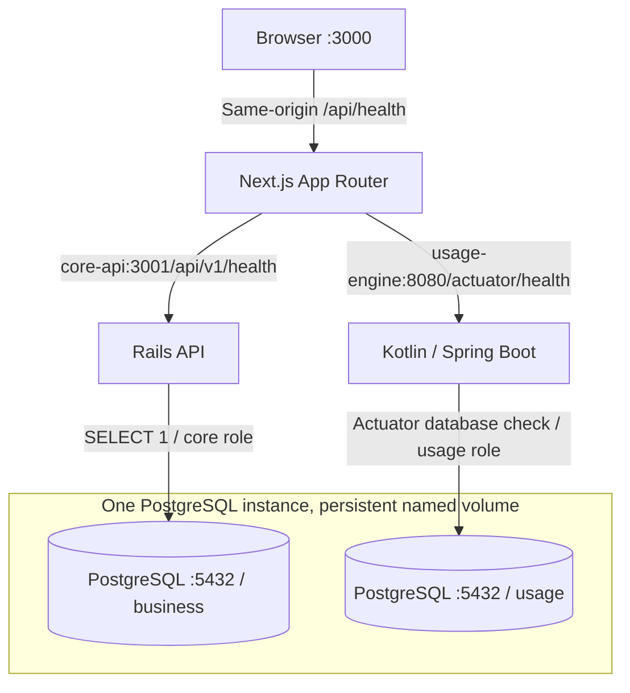

# TokenTrack architecture

TokenTrack is a local-first foundation for AI spending intelligence. Slice 1 implements service startup, database boundaries, a themed application shell, and database-aware health checks. The domain diagrams and financial rules in the root README remain conceptual future design.

## Responsibilities

**Next.js** owns presentation, responsive navigation, theme preference, and a small server-side health aggregator. The browser calls only the same-origin Next.js route. Internal URLs and database credentials never become `NEXT_PUBLIC_*` variables or enter browser bundles. The aggregator requests both backends concurrently, disables caching, validates response shapes, and limits each request to four seconds. The client checks on load and every fifteen seconds and also offers manual refresh. A connection failure replaces stale green indicators.

**Rails** owns the versioned business API and `business` schema. Its only endpoint runs a lightweight database query and returns a fixed JSON response with HTTP 200 or 503. Error details and credentials are not exposed. Conventional models, migrations, controllers, and RSpec are ready for future organizations, users, memberships, projects, authorization, budgets, approvals, attribution, and authoritative ledger posting. Those features are not implemented.

**Kotlin/Spring Boot** owns usage processing and the `usage` schema. JDBC config supplies a schema-bound PostgreSQL connection pool; standard Actuator supplies the database health indicator. Only health is exposed, component statuses are visible for Next.js, and connection details are hidden. Future ingestion, validation, model pricing, canonical usage events, execution statistics, and reliable event delivery belong here. No jobs or ingestion endpoints run yet.

## Database boundaries

PostgreSQL 17 contains `tokentrack_development` and an isolated `tokentrack_test` database for Rails tests. Both contain `business` and `usage`. Initialization creates independent login roles with no superuser or database-creation privileges. Each role owns only its schema; public schema access and public database grants are revoked. Search paths point at the owning schema. Neither application receives the administrator password.

These boundaries reduce accidental coupling and prevent one backend from silently modifying the other's tables. They are service ownership boundaries, not tenant authorization. Future organization scoping must still be enforced by Rails. There are no business tables in Slice 1; framework metadata may appear when running migrations.

Initialization scripts run **only on an empty PostgreSQL volume**. They bootstrap roles, databases, and schemas, not evolving application tables. Future changes use Rails migrations in `business` and, when usage tables are introduced, a normal migration tool such as Flyway in `usage`. No usage migration dependency is installed prematurely.

## Why two backends?

Rails supports transactional business workflows and authorization; Kotlin provides a separate home for typed ingestion, validation, and costing pipelines. This adds local build and operational cost, but keeps processing responsibilities separate from financial decisions. Sharing a local PostgreSQL instance keeps the foundation small without sharing write ownership.

The original README proposed a headless Kotlin worker and browser-facing Rails. Slice 1 explicitly adds Kotlin HTTP health on port 8080 and server-side Next.js access to both health endpoints. This is a narrow health integration; it does not establish a browser-facing usage business API.

## Future processing and Slice 2

Slice 2 will add organizations, users, memberships, scoped role assignments, and authorization tests in Rails. Next.js can consume those versioned APIs through server-side requests and use the established layout and tokens. The current placeholder identity has no security meaning and must be replaced when authentication is implemented.

Later, Kotlin will store validated, priced events and delivery records in `usage`, then deliver versioned events to Rails. Rails will validate identifiers and scope, choose attribution, and post each charge once in `business`. Retries require idempotency and reconciliation; a shared database does not make cross-service work a single transaction. A broker is not required for the planned local flow. Documented read-only usage views may be granted to Rails later if needed; no cross-schema grants exist now.

## Runtime assumptions

Compose explicitly selects development image stages. Rails and Next.js watch bind-mounted source. Kotlin's `bootRun` reads mounted source at startup; after edits run `docker compose restart usage-engine` to compile and restart reliably. Dependencies and build output use named volumes to keep host dependency directories out of containers.

PostgreSQL readiness gates backend startup. Next.js starts even if backends are still booting, showing checking/unavailable states until they respond. Containers use init processes and graceful stop periods. Ports bind to loopback for local use; this is not a production deployment configuration. CORS permits the configured development origin only and does not substitute for authentication.

Production Docker stages exist as build/runtime checks. Next.js uses a standalone build; Kotlin uses a built jar and JRE 21; Rails requires an external `SECRET_KEY_BASE` and can enable HTTPS behind a TLS proxy with `FORCE_SSL=true`. Real hosting, service authentication, tenant isolation, credential rotation, and deployment hardening are future work.
