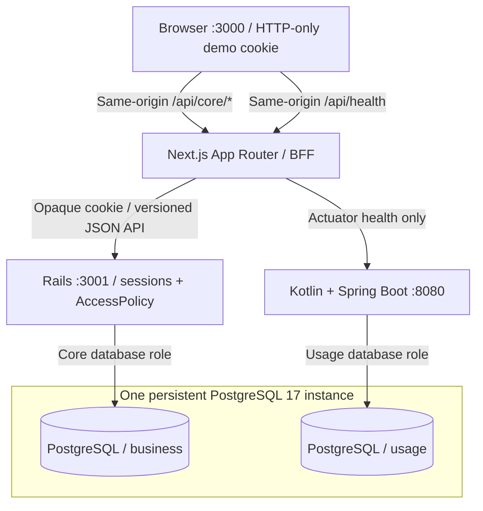
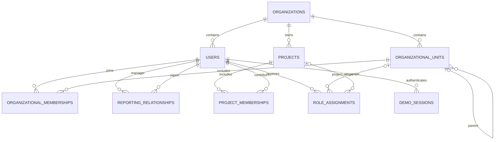

# TokenTrack architecture

Slices 1–2 implement the local four-service system, organizational data, demo sessions, scoped authorization, and a themed multi-role workspace. Usage ingestion, pricing, finance, and approvals remain planned.

## Responsibilities

**Next.js** owns presentation, responsive navigation, persistent themes, in-memory client caching, a narrow backend-for-frontend proxy, and server-side health aggregation. Organizational data comes from Rails. Neither Docker URLs nor database credentials reach the browser. Health remains independent and public; visible cards are in Settings and the Overview's expandable System connectivity section. Both backends are checked concurrently with four-second timeouts; database connectivity requires confirmation from both.

**Rails** owns organizations, units, people, memberships, reporting relationships, projects, permission grants, and their constraints. Every organizational API resolves a backend session and applies a request-scoped `AccessPolicy`. Presenters choose an allowed projection instead of serializing complete models. Only project name, description, and status can be edited in this slice. Future financial posting, budgets, attribution, and approvals belong here.

**Kotlin/Spring Boot** retains standard database-aware Actuator health and a schema-bound JDBC pool. It has no organizational tables or business endpoints. Future ingestion, validation, pricing, canonical usage events, execution statistics, and reliable delivery belong here.

## Implemented data model

IDs are UUIDs. Every tenant-owned row has `organization_id`. Composite foreign keys bind references to both the UUID and tenant; model validations provide readable errors. Unique constraints prevent duplicate memberships/grants. A partial unique index allows at most one primary home team per person, with optional additional memberships and many projects.

Units support arbitrary depth. Model checks and PostgreSQL triggers prevent unit/reporting cycles. The triggers acquire an organization-specific transaction advisory lock before checking ancestry, serializing hierarchy changes. Reporting supports line-manager and dotted-line edges. The profile chart renders the primary chain and labels additional relationships separately.

Role scopes use explicit unit/project foreign keys, not unvalidated polymorphic IDs. A database check permits only `employee/self`, `organization_viewer/organization`, `team_manager/unit`, and `project_lead/project`. An employee self scope resolves to its assigned user; organization scope resolves to the grant's tenant.

## Demo authentication

Entry requires `DEMO_AUTH_ENABLED=true` and Rails development/test environment. Production always disables it. An identity must be active, explicitly flagged `demo_identity`, and belong to a flagged demo organization. The public picker intentionally reveals only fictional names, titles, organization labels, and persona summaries.

Selection creates a random opaque token, stores only its SHA-256 digest and eight-hour expiry in `demo_sessions`, and sets an HTTP-only, SameSite=Lax cookie. Switching revokes the old session and rotates the token. Logout deletes it. Subsequent requests resolve the token to an active backend user. Role IDs, identity headers, tenant parameters, and frontend role state are never authentication authorities.

Next.js permits only known paths/methods, forwards only the demo cookie and expected parameters, disables HTTP caching, and bounds backend requests. JSON mutations need an allowed browser Origin; Rails independently checks the configured frontend Origin. The private `http://frontend:3000` development Origin is also permitted by the BFF for containerized browser checks. No privileged token enters localStorage.

This is local demo impersonation: anyone with access to the local app can choose its flagged fictional identities. It is not production identity verification. Ports bind to loopback and production rejects demo authentication.

## Authorization and projections

| Grant or relationship | Read scope | Editing authority |
| --- | --- | --- |
| Organization viewer | Own tenant's structure and management profiles | None implied |
| Team manager | Assigned unit subtree/members, reporting descendants, relevant projects | No project editing unless separately granted |
| Project lead | Explicit projects, participant directory metadata, relevant teams | Explicitly granted project metadata |
| Employee | Self, memberships, manager context, assigned projects, relevant directory | None implied |
| Project owner/lead membership label | Participation and directory context | No permission grant by itself |

Grants combine: Marcus can manage Platform Engineering and edit Developer Productivity without managing another project's contributors. A job function describes work, a reporting edge describes management, and project membership describes collaboration. None creates financial approval authority. Additional unit membership places a person in that unit's roster/read scope without creating a reporting edge.

Directory projections contain name, title, function, and primary-team context. Self/management projections additionally contain contact/status, memberships, and managers. Effective grants are exposed through `/me/access` only to their owner; project detail can show its explicit coordination grants as project metadata. Coworker profiles contain only projects visible to the actor. Reporting context requires self/management authority. Unit rosters are filtered server-side. Managers' default explorers focus on managed units.

Queries start with the active tenant, then narrow by policy. Out-of-scope lookups return 404; unauthorized actions on an otherwise visible resource return 403. `view=management` requests stricter access and cannot bypass policy. Search, filters, and pagination follow authorization. PostgreSQL supplies all counts. Distinct subtree counts avoid inflating departments when memberships overlap.

## Cache and UX boundaries

TanStack Query keys contain organization ID, user ID, and resource/filter path. Organizational data has a 30-second stale time and five-minute inactive in-memory retention. Project mutations invalidate relevant project, overview, unit-detail, and profile queries.

Identity changes hide old content first, cancel in-flight requests, clear caches, change the backend session, and refetch `/me`. Generation checks prevent older identity requests from restoring stale state. BroadcastChannel tells other tabs to clear and restore their sessions too. An expired session detected on a protected request returns the app to identity selection. Theme storage remains independent.

Skeletons cover initial content. Explicit actions use small pending indicators and disabled controls. Views have local error/retry states. Native expandable trees and focused reporting components avoid a graphing framework. Tables scroll inside their panels on narrow screens. There is no distributed cache.

## Database ownership and runtime

PostgreSQL has development and isolated Rails test databases. The core role owns only `business`; the usage role owns only `usage`; neither can create databases or access the other's schema. Application tenant isolation is enforced separately by Rails policies and tenant-bound foreign keys.

Docker initialization provisions roles/databases/schemas only on fresh volumes. Rails migrations evolve business tables. SQL snapshots preserve checks and triggers; a small Rails task hook removes schema-creation SQL because Docker, rather than the restricted role, provisions `business`. Load snapshots only into an empty bootstrapped schema. Future Kotlin tables will use a migration tool when introduced; no usage tables were added now.

Compose uses source mounts and dependency volumes. Rails and Next.js reload source; restart usage-engine after Kotlin edits. PostgreSQL readiness gates backend startup. Ports remain configurable localhost 3000/3001/8080/5432. Init processes and grace periods support shutdown. CORS permits the configured frontend Origin and does not replace authentication.

Production stages use Next.js standalone, Rails production mode, and a Kotlin jar/JRE. They are build/runtime artifacts, not a deployment. Production authentication, service authentication, HTTPS hosting, credential rotation, and deployment hardening remain future work.

## Why two backends and what comes next?

Rails supports transactional workflows and authorization; Kotlin provides a separate typed processing pipeline. This adds build/operational cost but keeps processing separate from financial decisions. Sharing one local PostgreSQL instance keeps infrastructure small without sharing write ownership.

Future Kotlin events will reference the organization/user UUIDs through versioned contracts and tenant-aware validation. Kotlin must not write business records. Priced-event delivery will require idempotency, reconciliation, and service authentication; the shared instance does not make cross-service work one transaction. A broker is not required for the planned local flow. Read-only usage views may be granted to Rails later; no cross-schema grants exist now.

Budget read/manage/approve permissions will be explicit scoped additions to the mapping and policy tests. Project participation, a manager title, or the current read grant must never silently become financial authority. No financial permission is active in Slice 2.
