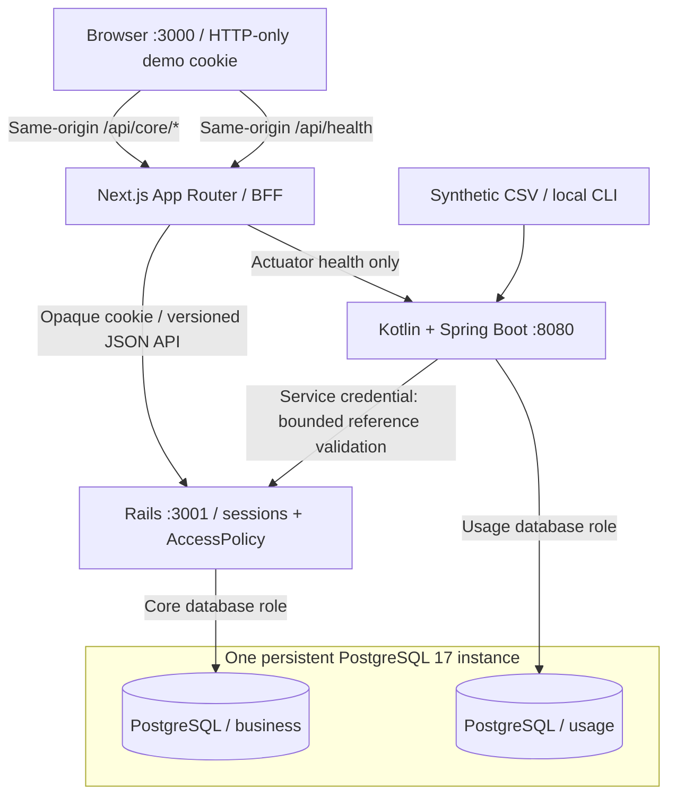
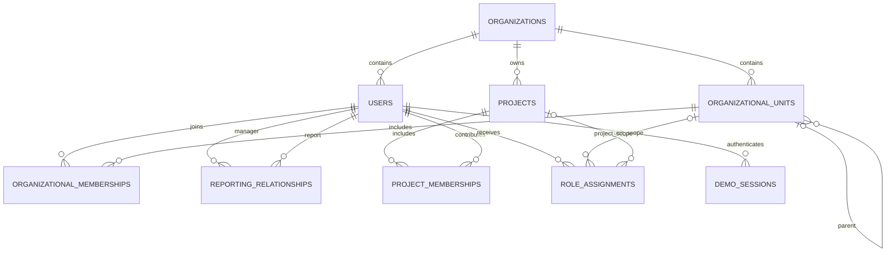
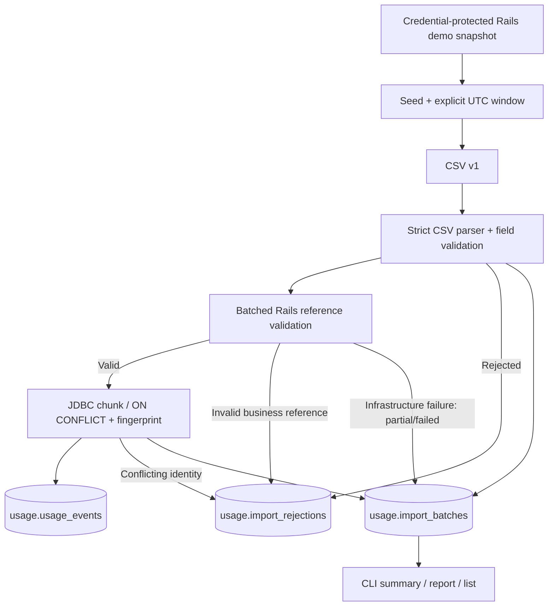
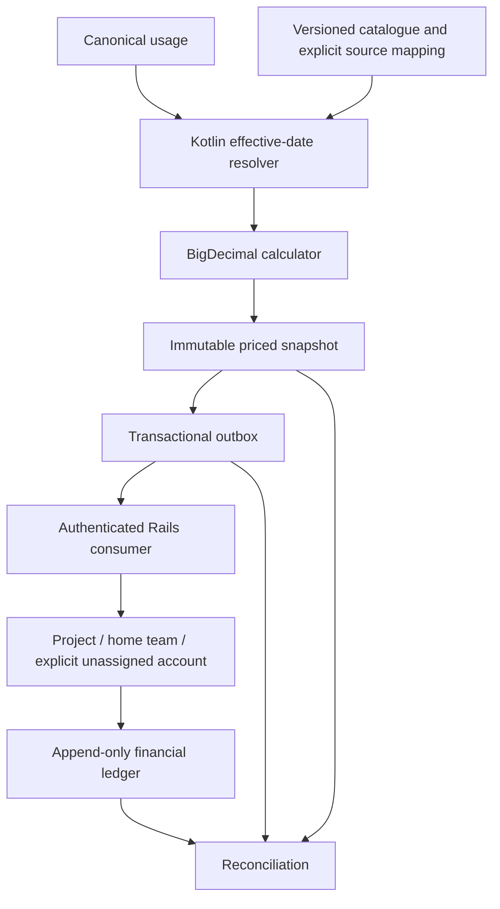

# TokenTrack architecture

Slices 1–4 implement the local four-service system, organizational data, demo sessions, scoped authorization, a themed multi-role workspace, cross-functional project management, and Kotlin usage ingestion. Pricing, finance, and approvals remain planned.

## Responsibilities

**Next.js** owns presentation, responsive navigation, persistent themes, in-memory client caching, a narrow backend-for-frontend proxy, and server-side health aggregation. Organizational data comes from Rails. Neither Docker URLs nor database credentials reach the browser. Health remains independent and public; visible cards are in Settings and the Overview's expandable System connectivity section. Both backends are checked concurrently with four-second timeouts; database connectivity requires confirmation from both.

**Rails** owns organizations, units, people, memberships, reporting relationships, projects, permission grants, and their constraints. Every organizational API resolves a backend session and applies a request-scoped `AccessPolicy`. Presenters choose an allowed projection instead of serializing complete models. ProjectManagement handles creation, metadata/lifecycle changes, contributor periods, and atomic ownership transfer. Controllers validate input and presenters expose explicit per-project action flags. Rails also owns budget accounts/periods, project-first attribution, idempotent expenses, transfers, corrections and reconciliation. Approval workflows remain future work.

**Kotlin/Spring Boot** owns CSV parsing/validation, reference orchestration, canonical usage persistence, deduplication, deterministic generation, and CLI import reports. Standard database-aware Actuator health remains the only public web endpoint. Flyway migrates usage with the restricted usage role; Spring JDBC writes events, import batches, and rejections. Kotlin also owns effective-dated pricing, exact BigDecimal calculation, immutable price snapshots, a transactional outbox and bounded delivery/reconciliation commands.

## Implemented data model

IDs are UUIDs. Every tenant-owned row has `organization_id`. Composite foreign keys bind references to both the UUID and tenant; model validations provide readable errors. Unique constraints prevent duplicate organizational memberships/grants. Project membership periods have joined_at/left_at; a partial unique index permits one active period per project/person and preserves prior periods when someone rejoins. A partial unique index allows at most one primary home team per person, with optional additional memberships and many projects.

Units support arbitrary depth. Model checks and PostgreSQL triggers prevent unit/reporting cycles. The triggers acquire an organization-specific transaction advisory lock before checking ancestry, serializing hierarchy changes. Reporting supports line-manager and dotted-line edges. The profile chart renders the primary chain and labels additional relationships separately.

Role scopes use explicit unit/project foreign keys, not unvalidated polymorphic IDs. A database check permits only `employee/self`, `organization_viewer/organization`, `project_creator/organization`, `team_manager/unit`, and `project_lead/project`. An employee self scope resolves to its assigned user; organization scope resolves to the grant's tenant.

## Demo authentication

Entry requires `DEMO_AUTH_ENABLED=true` and Rails development/test environment. Production always disables it. An identity must be active, explicitly flagged `demo_identity`, and belong to a flagged demo organization. The public picker intentionally reveals only fictional names, titles, organization labels, and persona summaries.

Selection creates a random opaque token, stores only its SHA-256 digest and eight-hour expiry in `demo_sessions`, and sets an HTTP-only, SameSite=Lax cookie. Switching revokes the old session and rotates the token. Logout deletes it. Subsequent requests resolve the token to an active backend user. Role IDs, identity headers, tenant parameters, and frontend role state are never authentication authorities.

Next.js permits only known paths/methods, forwards only the demo cookie and expected parameters, disables HTTP caching, and bounds backend requests. JSON mutations need an allowed browser Origin; Rails independently checks the configured frontend Origin. The private `http://frontend:3000` development Origin is also permitted by the BFF for containerized browser checks. No privileged token enters localStorage.

This is local demo impersonation: anyone with access to the local app can choose its flagged fictional identities. It is not production identity verification. Ports bind to loopback and production rejects demo authentication.

## Authorization and projections

| Grant or relationship | Read scope | Editing authority |
| --- | --- | --- |
| Organization viewer | Own tenant's structure and management profiles | None implied |
| Team manager | Assigned unit subtree/members, reporting descendants, relevant projects | No project editing unless separately granted |
| Project creator | No additional organization-wide read scope | Create projects in the granted organization and explicitly appoint an initial administrator |
| Project lead | Explicit projects, participant directory metadata, relevant teams | Metadata, staffing, ownership transfer, lifecycle; archived projects permit restoration only |
| Employee | Self, memberships, manager context, assigned projects, relevant directory | None implied |
| Project owner/lead membership label | Participation and directory context | No permission grant by itself |

Grants combine: Marcus can manage Platform Engineering and edit Developer Productivity without managing another project's contributors. A job function describes work, a reporting edge describes management, and project membership describes collaboration. None creates financial approval authority. Additional unit membership places a person in that unit's roster/read scope without creating a reporting edge.

Directory projections contain name, title, function, and primary-team context. Self/management projections additionally contain contact/status, memberships, and managers. Effective grants are exposed through `/me/access` only to their owner; project detail can show its explicit coordination grants as project metadata. Coworker profiles contain only projects visible to the actor. Reporting context requires self/management authority. Unit rosters are filtered server-side. Managers' default explorers focus on managed units.

Queries start with the active tenant, then narrow by policy. Out-of-scope lookups return 404; unauthorized actions on an otherwise visible resource return 403. `view=management` requests stricter access and cannot bypass policy. Search, filters, and pagination follow authorization. PostgreSQL supplies all counts. Distinct subtree counts avoid inflating departments when memberships overlap.

## Project lifecycle and collaboration

Projects retain their UUID when archived/restored. Planned and active can transition to each other or archived; archived can restore to planned or active. The UI restores the previous status, falling back to active for legacy archived rows. Archived projects remain readable with retained assignments/history, but metadata and staffing are read-only.

Creation derives organization and creator from the authenticated actor. A creator receives an owner membership and explicit project_lead grant by default. Choosing another initial lead explicitly grants that person authority and keeps the creator as a reviewer. In this local demo, initial/transfer administrators must be active selectable identities so responsibility stays reachable; ordinary contributors can be any active same-tenant employee.

Every staffing/lifecycle/transfer transaction locks the project row and checks a fresh policy inside that lock. Transfer creates or updates the target's active owner membership, downgrades former owner/lead labels to contributor, replaces all old project_lead grants with the target's grant, and commits together. Removing a member closes their period and revokes their project grants. The final administrator cannot be removed.

PostgreSQL deferred constraint triggers independently require at least one active administrator and require every project_lead grant to have an active same-tenant participant. The constraint is checked at commit, allowing multi-record creation/transfer. Tenant-bound foreign keys, role/status checks, period-order checks, and partial active uniqueness remain database-enforced. Existing project/membership IDs survive migration; historical creator can be unknown. The migration is deliberately irreversible because returning to all-time membership uniqueness needs history reconciliation.

Project lists batch contributor, lead, administrator, and primary-team summaries. Team groups aggregate active memberships by primary home unit (or unassigned). Expanding a group fetches a bounded member page; no graph library or full-organization participant payload is needed. Manager roster links derive from authorized active project assignments. Joining a project never changes home memberships or reporting relationships.

## Cache and UX boundaries

TanStack Query keys contain organization ID, user ID, and resource/filter path. Organizational data has a 30-second stale time and five-minute inactive in-memory retention. Project mutations invalidate project, overview, organization-summary, unit, and profile queries for the current organization/user. Only active views refetch; this does not reload the document.

Identity changes hide old content first, cancel in-flight requests, clear caches, change the backend session, and refetch `/me`. Generation checks prevent older identity requests from restoring stale state. BroadcastChannel tells other tabs to clear and restore their sessions too. An expired session detected on a protected request returns the app to identity selection. Theme storage remains independent. A separate project BroadcastChannel refreshes access and affected views in other same-origin tabs. The backend returns a fingerprint of effective grants and visibility; reduced/changed scope hides content and clears the old private cache before restoring it. Successful creation/assignment can safely expand access without blanking the page. Visible project views refresh every ten seconds; session access refreshes on focus and every fifteen seconds while visible. Other browser sessions discover revocation on a subsequent request, focus, or polling cycle; this is not push delivery. Rails denies revoked requests immediately, including queued writes after taking the project lock.

Skeletons cover initial content. Explicit actions use small pending indicators and disabled controls. Views have local error/retry states. Native expandable trees and focused reporting components avoid a graphing framework. Tables scroll inside their panels on narrow screens. There is no distributed cache.

## Database ownership and runtime

PostgreSQL has development and isolated Rails test databases. The core role owns only `business`; the usage role owns only `usage`; neither can create databases or access the other's schema. Application tenant isolation is enforced separately by Rails policies and tenant-bound foreign keys.

Docker initialization provisions roles/databases/schemas only on fresh volumes. Rails migrations evolve business tables. SQL snapshots preserve checks and triggers; a small Rails task hook removes schema-creation SQL because Docker, rather than the restricted role, provisions `business`. Load snapshots only into an empty bootstrapped schema. Flyway owns Kotlin migration history and the usage import/event/rejection tables. create-schemas=false preserves Docker-owned provisioning, and clean is disabled. Rails SQL snapshots remain business-only and unchanged by Kotlin migrations.

Compose uses source mounts and dependency volumes. Rails and Next.js reload source; restart usage-engine after Kotlin edits. PostgreSQL readiness gates backend startup. Ports remain configurable localhost 3000/3001/8080/5432. Init processes and grace periods support shutdown. CORS permits the configured frontend Origin and does not replace authentication.

Production stages use Next.js standalone, Rails production mode, and a Kotlin jar/JRE. They are build/runtime artifacts, not a deployment. Production user authentication, HTTPS hosting, service credential rotation, and deployment hardening remain future work. The local internal reference contract now uses a backend-only shared credential.

## Why two backends and what comes next?

Rails supports transactional workflows and authorization; Kotlin provides a separate typed processing pipeline. This adds build/operational cost but keeps processing separate from financial decisions. Sharing one local PostgreSQL instance keeps infrastructure small without sharing write ownership.

Kotlin events now reference organization/user/project UUIDs through the versioned CSV and tenant-aware Rails reference contract. Kotlin must not write business records. Priced-event delivery will require idempotency, reconciliation, and service authentication; the shared instance does not make cross-service work one transaction. A broker is not required for the planned local flow. Read-only usage views may be granted to Rails later; no cross-schema grants exist now.

Financial operations use an explicit organization-scoped financial_operator grant. Future budget approval permissions need their own scoped additions and policy tests. Project participation, a manager title, or the current read grant must never silently become financial authority. Slice 4 introduced no finance authority. Slice 5 adds a separate explicit organization financial_operator grant; normal organization seeds do not assign it.

## Slice 4 ingestion boundary

Rails POST `/api/v1/internal/usage-references/validate` accepts at most 100 keyed organization/user/optional-project/time references. A backend-only `USAGE_REFERENCE_TOKEN` authenticates it independently of demo cookies and browser Origins. The BFF does not expose internal routes. Replies contain validity and fixed error codes/fields, without employee names, emails, grants, or charts. A separate demo-only authenticated snapshot exports minimal fictional identifiers/functions/home-team IDs and recorded membership periods for deterministic generation. Kotlin gets neither business-schema access nor copies of organizational tables.

The event-time policy requires a known organization and currently active same-tenant user; project attribution additionally needs a same-tenant project and a recorded membership covering `[joined_at,left_at)`. Home-team ownership is irrelevant. Archive status does not erase history. Unknown past employment/status and historical project status cannot be inferred; events before known project membership are rejected, while unassigned usage remains valid. The generator avoids inventing old memberships and selects currently unarchived projects for its simulated workload.

Imports use at most 250 rows per normal transaction, with batched reference checks and a bounded import-local cache keyed by IDs and exact UTC event time. PostgreSQL uniqueness on organization/source/event ID handles concurrent replays. A canonical SHA-256 fingerprint distinguishes identical replay from conflicting payloads; original events are immutable. Import counts and row outcomes commit together. A file can mix tenants, but every row independently passes the Rails policy.

Malformed-column rows are rejected without dropping neighboring valid rows. Unsafe quoting stops scanning after preceding complete rows are committed. Infrastructure failures preserve earlier chunks and report unknown/unprocessed work instead of inventing invalid employees. Durable fifteen-minute heartbeat leases identify abandoned runs; recovered workers cannot resume committing. Restart/retry uses immutable identity keys rather than overwriting old data. The CSV contract defines exact counts, limits, error categories, and CLI exit codes.

See [usage-event-v1.md](../contracts/usage-event-v1.md) and [Slice 4 report](slice4.md). That Slice 4 change added no pricing, financial delivery, or analytics endpoints; Slice 5 additions follow below.

## Slice 5 financial processing

Snapshot/outbox insertion shares a usage transaction. Claims use SKIP LOCKED, leases and durable attempts. Rails commits receipt resolution, original expense and ledger entry atomically; unique canonical usage identity makes repeated delivery safe. Unsupported metadata remains unpriced; unresolved charge ownership remains held. Financial corrections append linked reversal/replacement entries, preserving original price/acknowledgement. Funding transfers have two equal/opposite funding legs and no expense.

Rails migrations own business tables; additive Flyway V2–V5 own pricing/delivery tables. Existing V1 canonical migration and original fingerprints are unchanged. No direct cross-schema writes, broker, dashboard, or browser financial endpoint is added. The financial bearer token is separate from read-only reference validation. See [financial ledger](financial-ledger.md), [pricing policy](model-pricing.md), [contract](../contracts/priced-usage-event-v1.md), and [executed verification](slice5.md).
