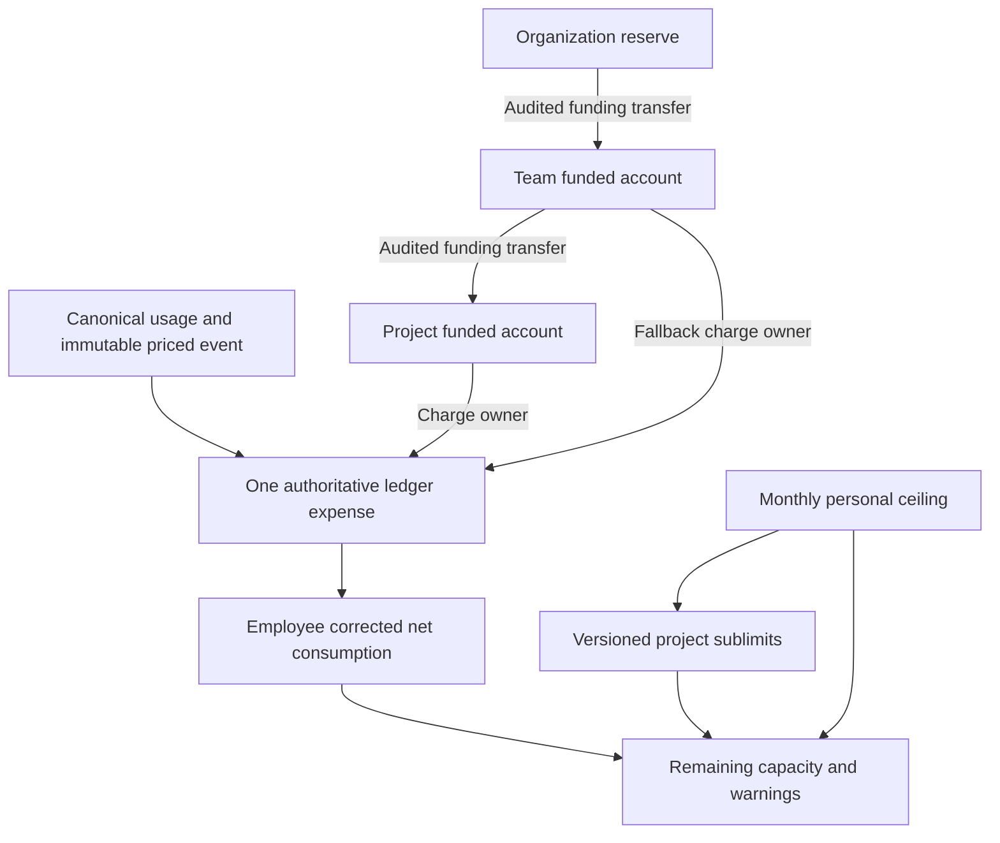

# Budgets and personal allowances — API v1

## Funding is separate from a spending control

Existing `BudgetAccount`, `BudgetPeriod`, `FinancialTransaction`, and `LedgerEntry` remain the financial source of truth. Reserve/unit/project/unassigned accounts hold allocated funding. Transfers move equal/opposite funding legs within one tenant, USD currency and UTC month; they create no expense or organization-level funding. Explicit reserve funding uses the existing `Finance::Operations#fund`. Period initialization creates empty periods only. No rollover, recurring funding or automatic allowance increase is implied.

A `SpendingLimit` is one employee/month/USD control, not an account. Its immutable revisions store ceilings, actor, reason, operation key, fingerprint and complete project partitions. `SpendingLimitAllocation` rows belong to one revision; a current-revision pointer selects the effective snapshot. A 500 USD ceiling with 240/160 USD project partitions leaves 100 USD unallocated, without moving any funded money.

Each expense is recorded once. It may count toward its employee's ceiling, project sublimit and charged account, but these perspectives are never added as separate expenses.

## Monthly consumption and partitions

Employee consumption uses the existing recursive ledger query rooted in posted receipts, including descendant reversals/replacements. It includes only that employee's corrected net expenditure in the selected UTC occurrence/accounting month. Project-funded expenditure instead uses the actual charged account's expense entries. No Kotlin price sum substitutes for either.

Personal remaining = ceiling − employee net consumption. Project remaining = project sublimit − that employee's project-associated net consumption. Negative remaining is an overrun, never a reason to discard or reassign expense.

Partitions are strict controls: each project's spending counts against its own sublimit and the personal ceiling. Unassigned usage counts against the unallocated portion. A project with posted consumption but no assigned partition has zero project capacity and can show an overage even while the overall ceiling has room. It does not silently consume another project's partition or the unassigned bucket. Before a ceiling is established, the interface labels it “not established” and does not invent zero ceilings.

Employees may redistribute **unused** capacity only. A project cannot be reduced below `min(previous sublimit, current posted project consumption)`; the unallocated portion has the analogous floor for unassigned usage. Existing overruns may remain but cannot be worsened by taking consumed capacity elsewhere. New/increased partitions require current participation in an unarchived, same-tenant project. Former assignments remain in history and may retain/reduce unused capacity, but cannot receive new discretionary increases.

Ceiling reductions must still cover existing partition totals. A manager does not silently overwrite an employee's partitions to force a lower ceiling. Repartition first where valid; a separate forced-administration workflow is deferred.

## Authorization

| Authority | Account read | Financial mutation | Personal controls |
| --- | --- | --- | --- |
| Employee | Only separately granted accounts | None | Own ceiling/consumption; redistribute unused own capacity |
| Team manager | Explicit team/project budget-reader scopes | None from manager role | Read direct-report controls; set ceilings only through a current capped delegation |
| Project lead | Explicit project-reader scopes | None from project leadership | Own personal controls; project-associated contributor expense only, never unrelated personal ceilings |
| organization_budget_reader | All own-tenant funded accounts | None | No additional private allowance access |
| financial_operator | All own-tenant funded accounts | Reserve funding, transfers, empty-period setup | Own-tenant ceiling administration, capped manager delegation/revocation |

Titles/personas confer no authority. Existing AccessPolicy combines explicit grants. An `AllowanceDelegation` binds one manager to a unit subtree, a maximum monthly ceiling and an inclusive month range of at most 12 months. The recipient must still hold the explicit manager grant; the employee must be that manager's direct line report with a primary home inside the delegated subtree. Caps from valid grants combine by maximum, never by adding money. A manager cannot raise their own ceiling through self-delegation.

Grant records preserve grantor/reason/time and allow one recorded revocation with revoker/time. Revocation is immediate for subsequent mutations. It creates no approval inbox, request routing or funding permission.

## Database integrity and concurrent writes

- Unique employee/tenant/month/USD parent; composite tenant foreign keys throughout.
- Finite nonnegative NUMERIC(38,15) ceilings/partitions/caps. Ruby BigDecimal parses decimal strings; no floats/exponents/negative values are accepted.
- Unique project per revision and unique revision number/operation key per parent.
- Deferred PostgreSQL checks require the parent's own latest revision and ensure every revision's partition sum fits its ceiling.
- Allocations can only be inserted in the revision's creation transaction. Committed revisions/allocations reject UPDATE, DELETE and TRUNCATE. Parent identity is immutable, and parent deletion/truncation is blocked.
- Mutations serialize through organization authority and employee/month advisory locks, then lock the parent and recheck a fresh actor. Expected-revision IDs reject lost updates. Complete new snapshots commit atomically.
- Identical operation-key/fingerprint retries return the existing revision; changed payloads conflict. Transfer/funding idempotency remains the existing ledger implementation.

These are DML protections under restricted service roles; privileged database owners can change DDL. Isolated committed concurrency tests use guarded, rollback-safe owner DDL cleanup only in the test database. No application bypass or development history reset exists. Demo reset now also refuses spending-control history.

## Warnings and forecasts

Global warning thresholds live in one initializer. Compose forwards optional `BUDGET_WARNING_APPROACHING_PERCENT` (default 75) and `BUDGET_WARNING_HIGH_PERCENT` (default 90); they must satisfy `0 < approaching < high < 100`. Exactly 100% is reached; above 100% is over budget. Zero capacity has no utilization percentage. UI components consume server warning states rather than calculating their own thresholds.

Forecasts use `net posted expense through selected as-of activity day / elapsed UTC calendar days × days in month`. The default as-of is the latest recorded posted-usage day in that selected month, not today's real date. At least two observed activity days are required. Sparse/no data and negative-net cases return explicit no-estimate states. Completed months return the actual modeled total. Projection-only division is rounded once to 15 decimals using HALF_EVEN; underlying expense precision is unchanged.

`as_of` affects forecasts only; account/allowance consumption totals remain the complete selected month's currently known ledger amounts. Corrections known now follow the original activity date; this is not reconstruction of what an auditor knew at a past posting instant. Forecast labels explain the method and incomplete-pricing limitations. Account-owner coverage cannot be inferred for unpriced events, so account forecasts conservatively carry an incomplete-coverage warning. Personal/managed coverage is separately labeled. Overruns never block ingestion or remove actual expenses.

## Routes and payloads

All routes are Rails `/api/v1`, authenticated with the existing demo session. Next.js permits only these exact public budget routes, carries no privileged service token, requires same-origin JSON for POST, and bounds request bodies. Foreign references return 404; missing authority 403; invalid amounts/months/partitions 422; stale revision/key/integrity conflicts 409. No unrestricted correction or grant-assignment endpoint is added.

`GET /budgets` accepts scalar `month=YYYY-MM`, optional `user_id`, `project_id`, `organization_unit_id`, `account_id`, forecast-only `as_of=YYYY-MM-DD`, `limit=1..100`, employee `offset`, and independent `history_offset` (offset bounds 0..100000). Months are 2000–2099. Defaults follow existing personal periods or available funded periods. User filters never broaden allowance-read scope. Account/project filters separately respect budget and activity permissions.

Response is `{data: ...}` with month/currency/as_of, authorized account controls/forecasts, own/selected allowance and its last 20 revisions, paginated authorized employees, eligible projects, separate personal/managed pricing coverage, net expenditure trend, paginated funding history, delegations/options and server capabilities. Monetary values are decimal strings. Financial account summaries never include ceilings as funding. Coverage failure leaves ledger facts usable and explicitly marks unknown coverage. Account history readers see only authorized legs; finance sees both transfer legs.

All POST bodies are JSON objects under `budget`, with exactly these fields:

| Route | Required budget keys |
| --- | --- |
| `/budgets/transfers` | from_account_id, to_account_id, month, amount, request_key, reason |
| `/budgets/funding` | account_id (reserve), month, amount, request_key, reason |
| `/budgets/periods` | month |
| `/budgets/ceilings` | user_id, month, amount, expected_revision (UUID or null for first revision), request_key, reason |
| `/budgets/allocations` | month, allocations, expected_revision, request_key, reason |
| `/budgets/delegations` | manager_id, unit_id, maximum_amount, from_month, until_month, request_key, reason |
| `/budgets/delegations/revoke` | id |

Allocation arrays contain ≤100 unique `{project_id:"FULL-UUID",amount:"250"}` rows and replace the complete current partition snapshot atomically. Non-allocation field values are strings except nullable expected_revision. Reasons are required, max 500 characters. Operation keys follow existing bounded ASCII key rules. Period initialization is repeatable and creates zero funding; revocation is repeatable without deleting its audit record.

## Frontend and future work

Budgets use the existing shell, Geist styles, shared accessible dialog and native financial trend chart. Transfer dialogs review source/destination/month/amount/reason, disable dismissal during posting and retain a cryptographically random key across unchanged retries. Allocation editors use 15-decimal BigInt arithmetic, show exact totals/unallocated capacity and disable invalid sums. Server validation remains authoritative.

TanStack Query keys include tenant, identity, scope fingerprint and full month/filter path. Mutations invalidate related budget, analytics and profile/project data; BroadcastChannel refreshes other authorized tabs. Existing identity switching cancels/clears caches, and manager delegation changes participate in the access fingerprint. Analytics gets a small, separately labeled single-month budget context rather than duplicated dashboards/charts.

Full approval requests, personal allowance increase requests, delegated approval chains, escalation, notifications, provider-side blocking and subscriptions remain deferred. Production identity verification remains outside the local demo. Historical home-team limitations and incomplete pricing coverage remain as documented in prior slices.
