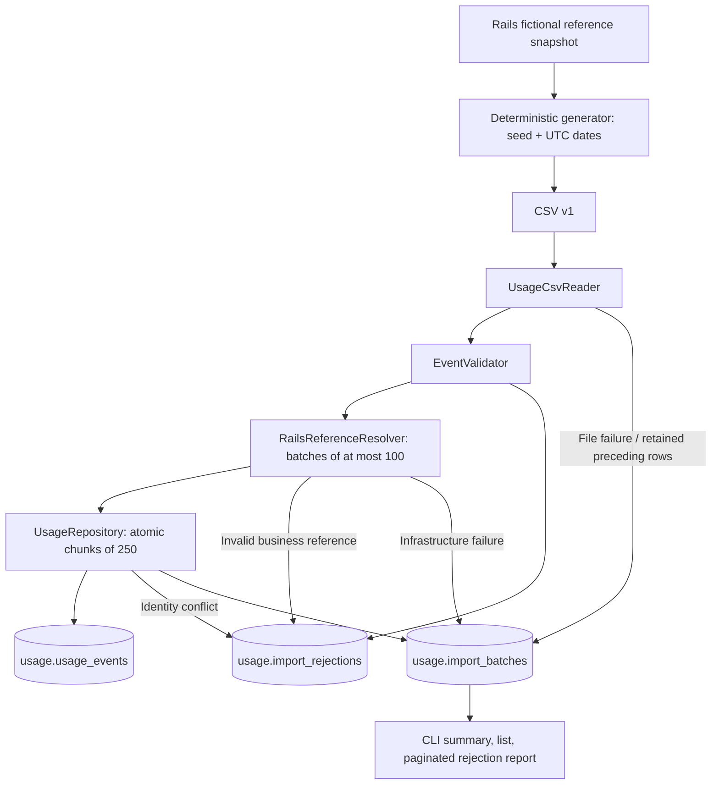

# Slice 4 — Kotlin usage ingestion, validation, and synthetic data

Implemented and verified locally on 2026-11-09. The starting branch was main, clean at the reviewed commit `08e0a419966b1f5d03d9a00b172f1e43f1a710f4` (projects and teams). Existing infrastructure, Rails models/constraints/seeds, Kotlin configuration/dependency locks/health tests, frontend proxy, contracts, and Slice 3 documentation were inspected before implementation. The Rails baseline passed 70 examples; the existing Kotlin health task was reviewed and remained current. Historical Slice 1–3 reports are unchanged.

## A. Implementation summary

TokenTrack now imports versioned token-usage CSV through a local Kotlin CLI. It validates fields and Rails-owned references, retains cross-functional project attribution, deduplicates immutable events, records rejected rows, and exposes operational batch reports. Flyway creates the first domain tables in usage; Rails remains the sole owner of business data.

The deterministic generator exports actual fictional Rails identifiers and membership history rather than reconstructing UUIDs. Its saved thirty-day dataset contains **7,737 events**, both organizations, **74 users, 16 primary teams, eight projects**, three illustrative provider/model dimensions, function-specific workflows, engineering/agent spikes, weekday/weekend differences, and **1,569 unassigned events**.

First import inserted all 7,737 with zero rejections. Exact replay inserted zero and counted 7,737 duplicates. Mixed invalid input retained valid records and produced persistent actionable errors. Reference outage accepted nothing and retried safely. All previous project/authentication/browser workflows remain functional.

No pricing, money calculations, budgets, ledger posting, financial delivery, analytics dashboards, public uploads, live provider integration, or new organizational models were added.

## B. Kotlin architecture



| Component | Responsibility |
| --- | --- |
| UsageCsvReader | Apache Commons CSV RFC 4180 parsing, strict headers, structural limits, recoverable column-count errors, unsafe-quoting detection |
| EventValidator | Required fields, version, identifiers, tokens, UTC timestamps, canonical UsageEvent creation, deterministic first-error reporting |
| RailsReferenceResolver | Backend-only HTTP authentication, bounded validation requests, response-policy/key checks, safe infrastructure/business error separation |
| UsageRepository | Spring JDBC, immutable conflict-aware inserts, fingerprint comparison, transactional row outcomes/counts, durable summaries and rejections |
| IngestionService | File bounds, parsing/validation orchestration, bounded exact-reference cache, chunk commits, partial/fatal finalization |
| SyntheticGenerator | Saved-snapshot generation with explicit seed/window and role/workflow patterns; no implicit current time |
| UsageCli / bin/usage | Non-web command process for import, report, list, snapshot, generate, and help; documented exit codes |

The service uses the existing Spring JDBC stack, not JPA. Commons CSV is pinned at 1.14.1; Boot 3.5.16 manages Flyway 11.7.2. Gradle locks cover compile/runtime/test configurations. Parser behavior follows [Apache Commons CSV](https://commons.apache.org/proper/commons-csv/); schema provisioning settings follow [Spring Boot 3.5 properties](https://docs.spring.io/spring-boot/3.5/appendix/application-properties/).

bin/usage compiles using the pinned container Gradle/JDK, atomically publishes its classpath, and invokes Java with original argument boundaries. It excludes/disables DevTools for CLI execution and sends compiler/log diagnostics to stderr, keeping stdout valid JSON. The server's explicit main class remains UsageEngineApplicationKt, avoiding ambiguity with the new CLI main. Production still packages the web service as a runnable jar; the supported local CLI workflow uses the development Compose container.

## C. Database design

Flyway migration `V1__usage_ingestion.sql` creates:

| Table | Main fields and integrity |
| --- | --- |
| usage.import_batches | UUID, stable source, bounded filename label, schema version, status, start/heartbeat/completion times, parsed/inserted/duplicate/rejected/infrastructure counts, scan-complete flag, failure code |
| usage.usage_events | UUID, organization/source/event identity, user/optional project UUIDs, provider/model/tool, BIGINT input/output/cached tokens, UTC event time, optional agent/workflow, first batch FK, version, canonical fingerprint, creation time |
| usage.import_rejections | UUID, batch FK, logical CSV record number, safe event ID, code/field/fixed message; no unrestricted raw payload |
| usage.flyway_schema_history | Flyway-owned applied-version/checksum history |

The unique `(organization_id, source, event_id)` constraint handles within-file, cross-file, and concurrent retries. `ON CONFLICT DO NOTHING` preserves the original event. A fingerprint lookup distinguishes identical replay from EVENT_ID_CONFLICT. The SHA-256 canonical payload includes every accepted business/dimension/token/time field, with explicit length-prefixing and null handling; it excludes filename, row order, batch ID, and ingestion time.

Database checks enforce identifier syntax, version, nonnegative/bounded tokens, positive input/output total, cached-input subset, timestamp bounds, nonnegative counts, and legal status/completion combinations. Indexes support organization/time, user/time, optional project/time, original batch, recent batches, and batch rejection pagination. Usage foreign keys reference usage metadata only; there are no cross-schema foreign keys or organizational copies.

A normal transaction contains at most 250 parsed records (service maximum 500). Events, row rejections, and count deltas commit together. A bad row does not roll back unrelated valid rows; a genuine database failure rolls back that chunk. Earlier chunks remain durable and retries resolve already-committed identities safely.

The existing restricted usage role owns all four tables. It cannot use business, and the core role cannot use usage. Docker still provisions schemas; Flyway uses create-schemas=false and clean-disabled=true. New changes require new versioned SQL migrations, not editing an applied file, Rails snapshots, or PostgreSQL initialization SQL. The isolated backend test database already has both schema owners, so no create-database privilege or volume reset was required. Rails structure.sql remains unchanged.

## D. Service communication and event-time policy

Rails adds a separate internal controller/service rather than extending demo impersonation. POST `/api/v1/internal/usage-references/validate` authenticates `USAGE_REFERENCE_TOKEN` with fixed-length digest comparison, independently of cookies/Origins. The frontend receives no such credential, does not forward it, and rejects the internal route with 404. JSON input is bounded to 1–100 uniquely keyed UUID/time references; replies contain only keys, validity, and stable failure details.

```json
{"references":[{"key":"reference_1","organization_id":"ORG-UUID","user_id":"USER-UUID","project_id":null,"occurred_at":"2026-11-10T14:30:00Z"}]}
```

```json
{"policy_version":"membership-period-v1","data":[{"key":"reference_1","valid":true}]}
```

Rails batches organization/user/project/membership queries. A known organization and currently active same-tenant user are required. Project attribution additionally requires a same-tenant project and a recorded period satisfying `joined_at <= occurred_at < left_at`, with null left_at open-ended. Engineering can contribute to a Product-led project without changing home team or manager. Unassigned usage needs no project membership.

Inactive users are currently ineligible; historical employment/status is unavailable, so this policy does not claim to verify past employment. Project archive/planning history is also unavailable; current project status does not override a recorded membership period. Earlier unknown membership and gaps between periods stay invalid. Removed members may attribute valid historical events; archived projects preserve usable identity/history.

Kotlin checks response version, exact result keys, content type, authentication, and infrastructure status. It batches at most 100 references per request and keeps at most 4,096 exact results inside an import, keyed by organization/user/project/time. It never treats an outage as an unknown employee. Rails database exceptions return safe 503 JSON. This is point-in-time validation, not a distributed transaction or permanent cross-schema guarantee.

GET `/api/v1/internal/usage-references/demo-snapshot` additionally requires demo mode in development/test. It exports only flagged fictional organizations/users, primary team IDs/functions, project IDs/current status, and recorded periods; no names, emails, reporting graphs, or grants. Production refuses this fictional snapshot export. The validator itself remains independent of demo mode and can validate legitimate configured service references.

## E. CSV contract

[usage-event-v1.md](../contracts/usage-event-v1.md) defines exact fields, patterns, normalization, limits, error codes, count semantics, and exit statuses. Each row has required version/event/org/user/project/provider/model/tool/input/output/time headers; project values can be empty. Optional cached_input_tokens, agent_run_id, and workflow_type headers may be omitted. Arbitrary metadata, prompt/completion fields, and unknown columns are rejected.

Example using illustrative UUIDs; the checked-in/generated fixture uses real exported identifiers:

```csv
schema_version,event_id,organization_id,user_id,project_id,provider,model,tool,input_tokens,output_tokens,occurred_at,agent_run_id
1,evt-000001,11111111-1111-1111-1111-111111111111,22222222-2222-2222-2222-222222222222,,openai,demo-code-v1,coding-assistant,12500,4200,2026-11-10T14:30:00Z,run-001
```

Event identity is stable inside the import's explicit source namespace. User/org/project UUIDs refer to Rails, not Kotlin-created entities. Provider/model/tool are stable string dimensions, not live catalogues or pricing records. Tokens are nonnegative decimal integers up to one trillion per input/output field; at least one must be positive. Cached input is a subset of input, not additional usage. Agent run and workflow describe optional context without claiming success/failure or productivity.

Values trim surrounding whitespace; provider/tool/workflow lowercase with Locale.ROOT. Provider-specific model identity and case remain intact. UTC times truncate to microseconds, matching PostgreSQL. Files are UTF-8, at most 20 MiB and 100,000 data records; decoded fields have a 512-character ceiling plus narrower identifier bounds. The parser accepts LF/CRLF and proper CSV quoting; generation writes LF for repository hygiene. Record numbers are logical CSV records, with header 1.

## F. Import and generator walkthrough

From the repository root, after setting distinct local database passwords and a generated backend-only credential in ignored .env:

```bash
docker compose up --build -d
docker compose exec core-api bin/rails db:migrate db:seed
docker compose exec -e RAILS_ENV=test core-api bin/rails db:migrate

demo/generators/generate-usage.sh 2026-11-10 2026-12-10 42
docker compose exec usage-engine bin/usage import /app/demo/fixtures/usage-events-v1.csv --source demo-synthetic-v1
docker compose exec usage-engine bin/usage list
docker compose exec usage-engine bin/usage report BATCH_UUID --offset 0 --limit 100
```

The helper first exports a credential-protected snapshot, then runs the Kotlin generator. Inputs are generator version, canonical snapshot, seed, and UTC start-inclusive/end-exclusive dates. Snapshot keys and set-like arrays sort before hashing; users and eligible project choices use stable ordering. The seed drives Java Random; no current time enters event generation. The CSV manifest records coverage and the snapshot SHA-256. Regenerating from the saved input was byte-identical in verification; another seed changes the stream.

The selected dates simulate a thirty-day window after recorded fixture joins, rather than backdating employment/project memberships. For earlier windows, missing membership yields unassigned generated activity. The generator excludes currently archived projects from simulated choices; historical ingestion still accepts them under the reference policy. A changed snapshot is a changed reproducibility input, even with the same seed. Regenerate after a later demo reset and choose appropriate explicit dates.

For one row, the CLI creates a running batch, parses CSV fields, validates/canonicalizes an event, batches its keyed reference with others, and obtains Rails validation. The repository inserts it under the source/event identity with its fingerprint and first batch UUID, then commits the chunk's outcomes and counts. Finalization records status/completion and prints JSON. Retrying the same row/source performs conflict-aware insertion and counts an identical fingerprint as a duplicate; its original UUID/payload/batch remain unchanged.

No PostgreSQL connection is needed to understand ordinary outcomes: import prints summary/error counts and a rejection page; list shows the newest twenty batches; report paginates details. The usage service remains available for health while a separate CLI process works. Stable source names must be reused across retries; filenames and import timestamps are not source identities.

## G. Error handling and operational limits

Row errors include invalid fields/version/tokens/time/UUID, zero tokens, invalid cached subset, foreign/unknown references, unestablished event-time membership, and conflicting identity. They identify batch, record, safe event ID, code, relevant field, and a fixed actionable message. Only the first deterministic field error is reported for a row. Rejections do not reserve an event identity.

Wrong column counts are recoverable. Missing/duplicate/unknown headers, invalid UTF-8, file limits, empty input, and unreadable files produce file diagnostics. Unsafe quoting cannot be reliably resynchronized; preceding complete buffered rows are committed and scanning stops with partial/failed status. No raw content or untrusted remote text is stored in diagnostics.

Reference timeout/authentication/protocol failure and database failures are infrastructure categories. Earlier chunks remain stored. Parsed-but-uncommitted rows appear as unprocessed, not rejected; unread input is not claimed as counted. Scan completion is distinct from successful processing. File-level diagnostics do not increment rejectedRows, which counts parsed data-row outcomes, so rejection-detail count can differ from rejectedRows.

Statuses are running, completed, completed_with_rejections, partial, and failed. A heartbeat commits with each chunk. If a process dies or database finalization is unavailable, import/list/report reconciles running batches stale for fifteen minutes as IMPORT_INTERRUPTED. Until then, running means active or not yet known to be interrupted. Chunk transactions lock and check status before writing, so reconciled workers cannot resume committing. Lost commit acknowledgment can be ambiguous, but replay is safe through immutable identities. Database unavailability can prevent writing final metadata; the CLI prints a stable persistence error with the batch ID when available.

Exit codes: 0 successful execution/import including duplicates; 2 completed import with rejected rows; 3 partial/fatal/infrastructure failure; 64 invalid arguments or unknown report batch. A successfully read report returns 0 even for a failed batch. Other abrupt OS/process termination has no normal CLI completion guarantee.

Current limits are deliberate: trusted local CLI, backend shared credential rather than production service identity/rotation, no upload/import UI, current-active user eligibility rather than employment history, no project-status history, no full role/ownership audit, no pricing/catalogue UUIDs, bounded in-memory CSV input, and no enterprise throughput claim. The main fixture source is demo-synthetic-v1; validation/malformed/outage demonstrations retain two valid events each in separate source namespaces. Use the main namespace when inspecting the primary synthetic workload. Rails demo:reset does not clear immutable Kotlin usage history.

## H. Tests and observed verification

Executed on 2026-11-09; observed results rather than planned checks:

| Command/check | Observed result |
| --- | --- |
| Baseline Rails suite | 70 examples, zero failures |
| `docker compose up --build -d` | Four-service stack built and started; existing volumes retained |
| Rails development/test `bin/rails db:migrate`, repeatable `db:seed` | Passed; no business schema/model migration or replacement IDs |
| `gradle dependencies --write-locks` | CSV/Flyway dependencies locked across runtime/test configurations |
| `docker compose exec usage-engine gradle test integrationTest --rerun-tasks` and final rerun | 36 unit/health tests and 11 genuine PostgreSQL integration tests passed, zero skipped/failures/errors |
| `docker compose exec core-api bundle exec rspec` | 80 examples, zero failures |
| Frontend `npm run lint`, `npm run typecheck`, `npm test` | Passed; five unit tests |
| Chromium `npm run test:projects` | Creation/staffing/history/transfer/archive/restore, cache revocation, and responsive regression passed |
| Chromium `npm run test:access` | Personas, sessions, permissions, tenant/cache isolation, filters/edit, loading/error/theme regression passed |
| Chromium `npm run test:browser` | Launch, real health, mobile/desktop navigation/themes, refresh, 404 recovery passed |
| `bin/usage snapshot`, `generate`, saved-input regenerate + `cmp` | Exported 74 users; 7,737 generated events; byte-identical reproduction |
| First `import ... --source demo-synthetic-v1` | 7,737 accepted, zero duplicates/rejections, completed; persisted count confirmed in PostgreSQL |
| Identical replay, including after LF normalization | Zero accepted, 7,737 duplicates, zero rejections; stored main count stayed 7,737 |
| Invalid fixture, source demo-validation-v1 | 17 parsed, two accepted, one duplicate, 14 rejected; exit 2 |
| Malformed fixture, source demo-malformed-v1 | Two complete valid rows accepted, INVALID_CSV file diagnostic, partial/scan incomplete; exit 3 |
| Import with `-e RAILS_REFERENCE_URL=http://core-api:9` | Failed with REFERENCE_SERVICE_UNAVAILABLE, one infrastructure failure, zero accepted/rejected and 17 unprocessed; exit 3 |
| Retry that same file/source with normal Rails URL | Two accepted, one duplicate, 14 rejected; no reserved/lost events from failed attempt |
| `bin/usage report` and `list` | Stored metadata/rejections readable without SQL; JSON stdout verified |
| Live Rails/Kotlin/Next.js health | All HTTP 200; both database connections confirmed |
| Schema ownership / permission queries | Four usage tables owned by usage role; neither application role can use the other's schema |
| Public BFF internal-path probe / frontend environment | 404; no reference credential in frontend environment |
| Production Kotlin and Rails image builds | Passed; local artifacts only, no deployment |
| Git/credential/log hygiene | Historical reports and Rails SQL snapshot unchanged; LF fixtures; no new credential patterns or unexpected application errors after final checks |

The 29 contract/parser tests cover valid/quoted/BOM/malformed/empty/header cases, unsupported versions/columns, required/UUID/time/identifier/token/cached validation, high token values, optional project, canonical UTC/microsecond equivalence, and model-case preservation. Three HTTP-client tests check bounded authenticated batching, outage categorization, and protocol failure. Two generator tests check deterministic/different seeds, all generated field validity, both organizations/functions/projects/time windows, and no invented earlier membership. Two existing health tests retain positive/negative database checks.

Eleven isolated PostgreSQL tests exercise actual Flyway schema creation and JDBC behavior: first/repeated imports across filenames, within-file duplicates/conflicts preserving original events, mixed validation/rejections, business-reference rejections, partial interruption/retry, cache reuse, unsafe/recoverable CSV failures, simultaneous imports, direct unique/check constraints and chunk rollback, usage-role business denial, and stale lease recovery/revoked continuation. Tests clean only their own UUID-scoped sources in the separate backend test database. The task always executes against external PostgreSQL state and refuses the development database.

Rails coverage adds service credential isolation, missing configuration, cross-functional/unassigned references, unknown/foreign tenant users/projects, half-open historical and rejoin gaps, archived projects, current inactive-user limits, bounded request syntax, safe database outage responses, and minimal demo-only exports. Existing 70 tests remain intact. The existing access browser test now explicitly awaits metadata-dialog closure before reopening it; no application UI component changed.

Main first-import batch: `002b330b-9f24-43cf-84cc-2b9939be15d7`. Initial replay: `71146ab6-1c0a-4449-be77-f73e36918d6b`. Mixed validation: `ae1ed934-e693-4c06-9bb0-291eb6f55e13`. Malformed partial: `07b5647c-a701-4150-9d31-231e4f2ba7e8`. Reference outage: `43605975-8e1f-480a-ae89-ed1fd0e40283`; safe retry: `c8842d3e-4e2e-4ef9-bb03-943cf1d2b3fd`. These IDs identify local verification history, not portable fixture identifiers. No Docker volume/database reset was performed. Browser project checks retain an archived review project/history as documented in Slice 3.

## I. Files changed

| Area | Changes |
| --- | --- |
| Kotlin | New domain, parser, validator, HTTP references, JDBC repository, import orchestration, generator, CLI, wrapper, CLI logging; explicit server main; Flyway/CSV dependencies and locks; usage-only SQL migration |
| Kotlin tests | Contract, reference-client, generator, and tagged PostgreSQL integration suites; existing H2 health test disables Flyway only for its context |
| Rails integration | Internal read-only reference/snapshot controller, focused batch validation service, routes, credential log filtering, request specs; no organizational model/schema changes |
| Local configuration | Backend-only token example/Compose wiring, internal Rails URL, isolated usage test DB variable, mounted demo directory; real local token only in ignored .env |
| Contracts/fixtures | Usage v1 specification; reference contract; generator helper/guide; exported fictional snapshot, manifest, 7,737-row CSV, mixed invalid fixture, malformed fixture |
| Frontend | One browser-test synchronization wait; no application component, proxy, navigation, or analytics change |
| Documentation | README, architecture, development, contracts/demo/service guides, and this report; historical reports preserved |

## J. Slice 5 readiness

Immutable canonical rows now supply stable organization/user/project references, source/event identity, provider/model/tool dimensions, UTC event time, input/output tokens, cached-input subset, optional agent/workflow, original import batch, and a canonical fingerprint. This is the trusted input foundation for later pricing and financial delivery.

Slice 5 must define provider/model catalogues, effective-dated price records, units/currency/rounding precision, cached versus uncached input handling, immutable price snapshots, and explicit unknown-model/price policies. Model strings preserve source identity; catalogue UUID mappings should be introduced without rewriting raw usage. Price calculations must use exact decimal/money rules, never floating-point approximations.

Future priced-event contracts need event/tenant/version identity, cost components and pricing provenance, an idempotent delivery key, durable delivery/outbox attempts, authentication, acknowledgment/retry, and reconciliation. Rails will independently authorize attribution and financial ledger posting; Kotlin must not acquire financial authority or write business tables. Future project/employee analytics must reconcile source identity and tenant scopes, account for archived/historical references, and avoid double-counting cached tokens or replayed events. Membership/reference-policy provenance may need explicit version storage when policies evolve.

These are identified interfaces and migrations for later slices. No prices, costs, outbox, ledger entries, funding approvals, or spend dashboards exist in Slice 4.
