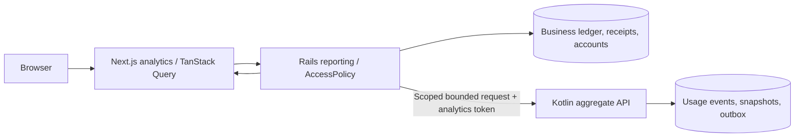

# Slice 6 — analytics and reporting dashboards

Implemented and verified November 10, 2026 UTC, starting from clean `main` at reviewed commit `c8a016492d7eb2173329d39e594d0e0967e75123` (`token pricing`). The existing canonical events, rate snapshots, outbox and append-only financial history were preserved. No fixture extension, pricing recalculation, financial reset, or new financial posting was used for this slice.

Open **http://localhost:3000/analytics** after choosing a demo identity. [Analytics contract](analytics-contract.md) defines exact metrics/scopes; [machine-readable verification](verification/slice6-results.json) records actual observed results. The application remains local-only; no hosted deployment was made.

## A. Implementation summary

Rails now serves an authorized combined analytics report, querying its own ledger/receipts/accounts and requesting bounded token aggregates over an internal HTTP contract. Kotlin now provides a separately authenticated usage analytics read API. Next.js now renders role-aware dashboards with dates/granularity, exact financial summaries, responsive charts, current-home-team/project/model rankings, measured comparisons, model/tool/employee tables, coverage, scoped account utilization and posting audit.

The existing AccessPolicy/session system remains authoritative. Additive migrations introduce indexes and explicit read-only team/project budget grants. `analytics:demo_access` was executed explicitly for flagged local demo identities; it created 12 team and 15 project reader grants at setup time. It created no funding or expenditure. Financial mutation permissions remain separate.

## B. Reporting architecture

`GET /api/v1/analytics` is the coherent public reporting endpoint. `POST /internal/v1/analytics` is backend-only Kotlin. The BFF allowlists only the Rails GET; direct internal proxy attempts return 404. Missing Kotlin credentials return 401. `USAGE_ANALYTICS_TOKEN` is independent from reference and financial credentials and is passed only to the backend containers.

Kotlin uses SQL aggregate queries with explicit tenant/population/time predicates. Rails uses a recursive financial family query rooted in posted receipts to include every linked reversal/replacement. It performs bounded grouping/label joins on aggregates rather than loading canonical event rows. PostgreSQL ownership remains unchanged: Rails still cannot SELECT usage events and Kotlin cannot SELECT ledger entries. Each service uses repeatable-read snapshots, while the cross-service combined report is eventually consistent across HTTP requests.

## C. Metric definitions

- Original expenditure: original usage-charge expense entries.
- Adjustments: actual linked reversal/replacement expense entries.
- Net expenditure: original plus adjustments, excluding funding/transfer deltas.
- Funding/remaining/utilization: authorized account funding, minus account net expense, and expense/funding when funding is positive. These use full intersecting UTC accounting months, separately labeled from activity dates; activity-only subgroup filters have no applicable account allocation.
- Input/output/cached input: canonical Kotlin token sums. Cached tokens are already included in input, so total tokens = input + output.
- Coverage: priced/events; missing rates, unsupported profiles, pending delivery and unresolved owners remain visible. Unpriced cost is unknown, not assumed free. Spending is labeled **modeled expenditure for priced, posted usage**.
- Activity charts: start-inclusive/end-exclusive usage occurrence dates; corrections remain with original activity/accounting assignment. Posting audit uses separate transaction creation dates and paginates original/reversal/adjustment rows.
- Daily/weekly/monthly buckets: UTC, Monday weeks, explicit ISO timestamps and zero-filled empty buckets. Complete-week/month comparisons are anchored no later than the available data end for overlapping ranges. Partial/outside recorded coverage suppresses ordinary percentages. A genuine zero baseline has an explicit new-activity/no-activity state, never infinity. Signed expense deltas remain exact strings.

Employee/current-home-team/project/model/tool perspectives each reconcile independently to one event population and one net expenditure. They are never added together. Project-funded expenditure is derived from account entries; project-attributed activity can include fallback accounts. Current home-team reporting is explicitly labeled because canonical usage v1 lacks historical employment membership. Original ledger home-unit snapshots remain preserved in audit data.

Model groups retain original provider/model and separate resolved provider/model/billing basis. Synthetic proxy mappings remain labeled; unpriced profiles are null. No subscription, productivity, savings or retry-storm claims are inferred.

## D. Authorization

Organization viewers can read own-tenant activity; managers can read established managed users; project leads can read led-project activity; employees can read themselves. Grants combine as a union, with every filter intersecting that population. Ordinary directory visibility and project membership do not reveal complete private usage. In particular, Marcus has both Platform management and Developer Productivity leadership; his cross-team contributor activity remains restricted to the led project. Priya opening Jordan does not gain Jordan's unrelated activity.

Budget visibility requires a separate explicit financial_operator, team_budget_reader or project_budget_reader grant. Reader grants authorize the corresponding accounts only and never authorize funding, transfer, correction or broader private activity. Existing organization_viewer authority alone does not become a financial mutation permission.

Actual full-window persona observations:

| Persona | Effective scope | Employees with visible activity | Associated net expense USD |
| --- | --- | ---: | ---: |
| Olivia Chen | leadership | 64 | 423.91566928 |
| Marcus Rivera | manager | 25 | 122.661715865 |
| Priya Shah | project_lead | 36 | 154.97964106 |
| Jordan Lee | employee | 1 | 12.82026142 |

These are observed scope-specific database values, not seeded UI totals. API tests deny foreign tenants, unrelated employees/projects/teams and malformed/unknown filters. Browser tests verify restricted employee funding, role switching and internal route denial.

## E. Frontend walkthrough

The dashboard preserves the Geist/neutral/thin-border design, with restrained green trend accents. Six compact KPI blocks cover net expenditure, input+output tokens, active users, coverage, authorized funding and utilization. A compact bar provides presets, custom UTC dates, granularity and authorized team/project/employee filters. Model/tool row clicks apply their original-identity filters; removable chips preserve date context across related drill-down.

A responsive native SVG chart switches between expenditure and tokens, with exact values available by hover or keyboard focus. It resizes its coordinate system on mobile so date/axis labels remain legible. Current-home-team activity, project-attributed activity and original model mix support connected exploration. Project headings link to existing metadata/contributor history. Tables provide sorting, pagination, profile/project links, original-versus-price-profile context, active-project/user counts and exact monetary tooltips. Account tables distinguish full-month funded expenditure. Ledger audit exposes activity/posting/accounting dates and signed correction entries.

Weekly/monthly cards show token and expense changes, recorded coverage and directly measured contributors across employees, projects, models and tools. Input/output/cache components are available in expandable details. Missing historical periods show a partial-window explanation, not a fabricated growth claim.

TanStack Query keys include tenant, identity, access fingerprint, dates, scope filters and granularity. Previous authorized data is retained only within the same identity/scope. Existing session switching cancels/clears caches, including across tabs. Initial skeletons, inline refresh state, retry/reset actions and empty-range recovery are implemented. Export downloads only the current authorized report JSON. BigInt formats decimal strings; JavaScript number conversion is confined to geometry, sorting and display percentages.

Visual verification inspected desktop dark mode and employee mobile light mode. Browser regression found an existing asynchronous placeholder route producing a Next.js development `Performance.measure` negative-timestamp error. Replacing that catch-all with synchronous budgets/requests/settings placeholder pages preserved those URLs and removed the runtime error; the final smoke suite passed without ignoring errors.

## F. Actual reconciliation

Verification used activity range **2026-11-01T00:00:00Z through 2026-12-11T00:00:00Z**, covering the complete existing fixture. Each tenant was queried independently using its own authorized leader:

| Organization | Events | Priced | Unpriced | Net expenditure USD |
| --- | ---: | ---: | ---: | ---: |
| Aperture Technologies | 6665 | 6281 | 384 | 423.91566928 |
| Northstar Labs | 1088 | 1024 | 64 | 76.873540995 |
| Combined verification only | 7753 | 7305 | 448 | 500.789210275 |

Combined token totals: **276,736,522 input**, **85,448,804 output**, **79,614,921 cached input subset**; total input+output **362,185,326**. No cross-tenant combined endpoint was added; the verification script sums independently authorized tenant results.

Financial reconciliation remains **balanced_with_unpriced_usage**, exit 2 for deliberately incomplete pricing coverage: 7,305 delivered and posted, zero pending/dead/unresolved owners, zero missing postings/outbox, zero amount discrepancies/payload conflicts and zero integrity violations. Gross original charges are **500.795710275 USD**, correction effect **-0.0065 USD**, net **500.789210275 USD**. The recorded mini example remains original 0.1065 minus 0.1065 plus replacement 0.1000; report aggregation shows the corrected 0.1000.

For both tenants and the measured overview/weekly/project/employee scopes, SQL-derived summary totals equal the sum of every time-series, employee, current-home-team, project-attributed, model/profile and tool breakdown. Project drill-down Fraud Detection reports **36.859294375 USD** associated net expense; its actual project account ledger is reported separately. No grouping creates another charge.

Before/after immutable baselines match exactly:

- Canonical usage: **7,753**, checksum `6a12d8cba38e9026692218e10a206ba5` using `md5(string_agg(id::text || payload_fingerprint, ',' ORDER BY id))` over all sources.
- Ledger entries: **7,417**; financial transactions: **7,364**.
- Ledger net expense: **500.789210275 USD**; aggregate organization/month funding: **400,000 USD**.
- Original fixtures, price snapshots and historical Slice 1–5 reports unchanged; no resets or pricing/posting commands ran to generate dashboard metrics.

## G. Executed tests and performance

| Executed command/check | Observed result |
| --- | --- |
| `docker compose up -d` | Services running with independent analytics credential |
| Rails development and test `db:migrate` | Additive analytics migration applied |
| Kotlin Flyway | V1–V6 successful |
| Rails `bundle exec rspec` | **119 examples, zero failures** |
| Kotlin `gradle test integrationTest` | **86 tests: 49 unit + 37 real PostgreSQL, zero failures** |
| Frontend `npm run lint` | Passed |
| Frontend `npm run typecheck` | Passed |
| Frontend `npm test` | **8 passed** |
| `npm run test:analytics` | All four personas, correction/group reconciliation, scope denial, dates/granularity/drill-down, internal auth, loading/error/empty, identity cache, themes/mobile passed |
| Existing `test:browser`, `test:access`, `test:projects` | All passed, including no runtime exceptions |
| Production Docker builds | Rails, Kotlin and Next.js passed |
| Live Rails/Kotlin/frontend health | HTTP 200, databases connected/UP |
| Foreign-schema SELECT checks | Denied for both service roles |
| Immutable baseline check | Counts, checksum and exact ledger totals unchanged |
| Financial CLI reconciliation | Balanced with 448 explicitly unpriced; no financial discrepancy |
| Changed-file/secret checks | No configured secret values in changed files; ignored `.env` retained |

Reporting latency was measured with three local runs of the complete Rails report service, including its internal Kotlin HTTP calls and ledger queries, excluding browser/BFF overhead. Concurrent production builds ran during this measurement; these are actual observed durations, not production capacity claims:

| Report | Run 1 / 2 / 3, milliseconds |
| --- | --- |
| overview | 611.76 / 314.21 / 316.37 |
| timeseries_week | 299.11 / 225.0 / 338.88 |
| project | 253.91 / 78.33 / 114.82 |
| employee | 157.41 / 104.21 / 96.18 |

An EXPLAIN ANALYZE of scoped Jordan token aggregation used `usage_analytics_user_time` through a bitmap index scan, 153 rows, **0.070 ms execution** and 31 shared-buffer hits. Additive tenant/time/user/project indexes support bounded reads; correction-parent and financial posting-time indexes support ledger queries. No larger synthetic dataset, 10,000-employee load or materialized-view strategy was tested or claimed. Direct aggregation is sufficient for the observed 7,753-event local dataset.

## H. Files changed

- Rails: AnalyticsController; analytics scope, usage HTTP client, recursive ledger query and combined report; AccessPolicy budget-read helpers; RoleAssignment reader roles; explicit local demo access rake command; 13 reporting request tests.
- Kotlin: authenticated internal aggregate controller/service, bounded-body filter, additive Flyway V6 indexes, eight PostgreSQL analytics tests and two body-bound unit tests; analytics token config.
- Business database: additive reporting indexes/read-grant constraint migration and SQL snapshot update. No existing financial schema redesign or history mutation.
- Next.js: `/analytics`, responsive chart/dashboard/tables, decimal/date utilities and tests, exact GET proxy/filter allowlist, navigation/footer status, dedicated synchronous existing placeholder routes and analytics browser suite.
- Configuration/docs: separate backend token/URL wiring, README/architecture/development/contracts/demo updates, this report, analytics contract and machine-readable observed results.

## I. Known limitations

Modeled expenditure excludes unpriced events and unsupported provider billing scenarios, fixed subscriptions, taxes and invoice-specific adjustments. It is not a claim of actual provider invoices. Original illustrative models and synthetic proxy mappings remain visible.

Team activity uses current primary-home membership, not reconstructed historical employment. Project activity uses recorded canonical project identity; funded-account ownership is separate. Allocation totals span full intersecting accounting months and are not daily prorated. Account budgets are hidden for incompatible activity-only filter intersections rather than inventing an allocation.

Calendar comparisons depend on recorded coverage; missing outside-window dates cannot be treated as fully observed zero usage. Each service snapshot is internally consistent, but the combined HTTP report can lag concurrent ingestion/posting; refresh and the separate financial reconciliation command expose this boundary.

Ranges are ≤366 days; scoped user lists/rosters and dimension groups are bounded to 200, project lists to 100, and audit pages to 100. Larger populations must narrow filters. Tables paginate the bounded aggregates in the client; audit pagination is server-side. Production-scale latency and real identity/provider integrations remain unproven/deferred. No cached summary tables, broker, cloud deployment, ML anomaly system or agent productivity scores were added.

## J. Slice 7 readiness

Read-only account funding/expense/remaining/utilization and explicit scoped budget readers provide a foundation for future employee allowances, allocation controls, budget warnings and project sublimits. Existing immutable costs, correction-aware net expenditure, account ownership and scoped drill-down allow those future controls to explain their effects without duplicating charges or treating allowances as money. Funding requests, approval workflows, user-facing transfers and personal limits were deliberately not implemented in this slice.

Reproduce through [development instructions](development.md#slice-6-analytics). Keep the existing persistent usage and financial data; read reports and repeat grant setup idempotently instead of resetting history.
